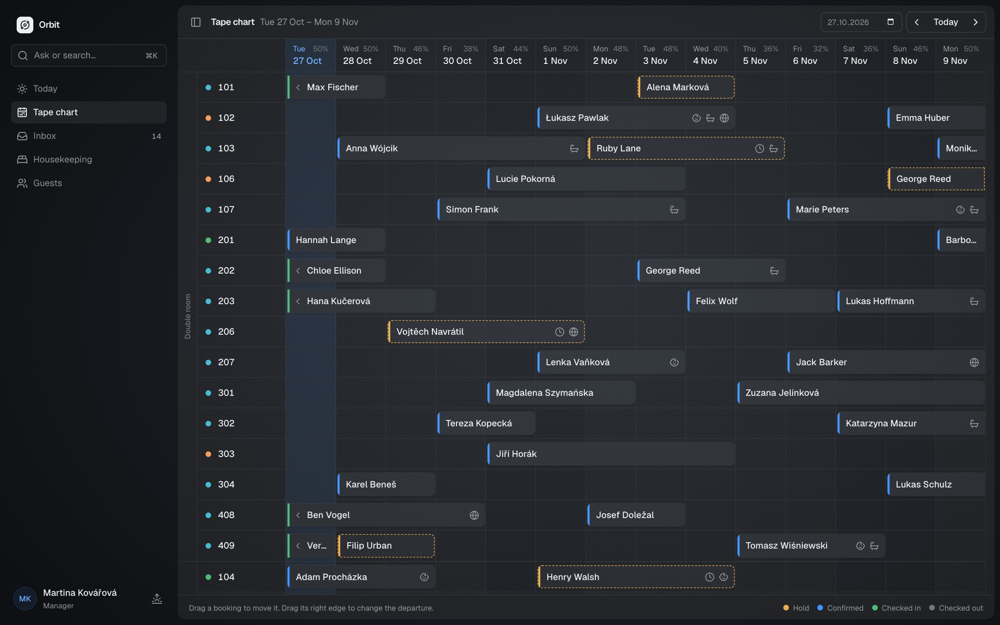
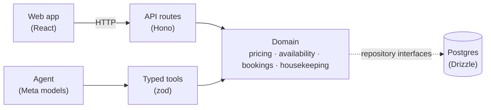

# Orbit PMS

An AI-native property management system for small hotels: anything you can click, you can also just ask for.



## Why

I'm the assistant manager at a small wellness guesthouse in the Jizera Mountains in Czechia. A day at the front desk of a place like ours means guest emails in Czech, German, Polish and English, Booking.com messages, per-person prices with child discounts and wellness add-ons, and housekeeping updates passed along by phone or in the corridor. Most hotel software leaves all of that to the person at the desk, and where AI shows up, it's usually a chat window on the side.

The demo runs as a fictional US mountain lodge on Pacific time: room rates in dollars, occupancy and sales tax added on the bill, US dates and an English-speaking team, with guests writing in from all over. The same app runs a Czech guesthouse in crowns, per person, with VAT included: currency, taxes, guest-book rules and time zone are settings ([ADR 0013](docs/decisions/0013-configurable-region-us-demo.md)).

Orbit is built the other way round. One set of hotel rules (availability, pricing, the booking lifecycle, housekeeping) runs everything. The screens call those rules, and so does an agent running on Meta's models, so the agent can do anything the UI can and never invents a price.

## What it does

### Ask anything, from anywhere

Press <kbd>⌘K</kbd> and type what you need: "is a family room free from Friday?", "move the Schulz booking to 201", "who arrives today?". The agent picks tools, shows each step in plain words, and puts anything that would change a booking on a confirm card. Nothing changes until a person clicks Confirm, and every change lands in the audit log.


### An inbox that prepares the answer, in two languages

Email, web forms, phone notes and Booking.com messages land in one mail client: conversations with their history, folders, channel filters and search. Opening a message costs nothing. When staff click "Prepare a reply", Orbit reads the conversation, pulls out the dates, party, children's ages and wishes, finds free rooms, prices them with the real pricing rules, and drafts a reply in the guest's language, shown side by side with the receptionist's own language. Either side can be edited and translated into the other. A price guard checks every amount in the draft and its translation against the quote, so a wrong price never reaches a guest. One click puts a hold on the room.


### Housekeeping by voice

Housekeepers record a note on their phone, in their own language: "205 je hotový, v 204 nefunguje televize". Meta's speech-to-text transcribes it, the model reads it into room updates, and Orbit sets the room statuses and creates repair tasks. These are low-risk and easy to undo, so they apply straight away and the note shows exactly what changed. The board highlights rooms where a guest arrives today but the room isn't inspected yet, and cards can be dragged between columns.


### A tape chart that follows the day

The Mews-style tape chart groups rooms by type. Drag a booking to another room or other dates, or drag its right edge to change the departure; every drag goes through the same rules as the agent. The optional daylight theme turns the app light at 06:30 and dark at 19:30, with a soft glow that follows the sky: pink dawn, pale midday, orange-violet sunset, then moonlight.


All guests, bookings and messages in the demo and the screenshots are synthetic. Prices are placeholders.

## How it uses Meta's models

Every AI feature runs on the Meta Model API through the Vercel AI SDK. The models do language, the domain does the facts:

| Feature            | Model                                          | What the model does                                                      | What it never does                                                           |
| ------------------ | ---------------------------------------------- | ------------------------------------------------------------------------ | ---------------------------------------------------------------------------- |
| ⌘K agent           | `muse-spark-1.3`                               | Plans multi-step tool use over 31 typed tools, writes the answer         | Computes a price or availability, or changes a booking without a click       |
| Inbox extraction   | `muse-spark-1.3`                               | Structured output: kind, language, dates, party, child ages, wishes      | Picks rooms or prices                                                        |
| Reply drafts       | `muse-spark-1.3`                               | Writes the reply in the guest's language around the exact quoted totals  | Runs before staff ask, or sends a reply; a wrong amount is redone or dropped |
| Translation        | `muse-spark-1.3` (`META_MODEL_TRANSLATE`)      | Puts drafts and guest messages into the staff member's language and back | Changes an amount: such a translation is redone or refused                   |
| Housekeeping notes | `muse-voice-transcribe-1.0` + `muse-spark-1.3` | Transcribes the recording, reads it into room/status/issue updates       | Changes bookings; unknown rooms and forbidden changes are skipped            |
| ID scans           | `muse-spark-1.3` (vision)                      | Reads a phone photo of an ID card or passport into guest-book fields     | Saves them: staff review every value; the photo is never stored              |

Muse Spark always reasons before answering, so the reasoning effort is set per feature to the lowest level that keeps quality, measured with the evals and live runs: `minimal` for extraction, drafts, notes and ID scans, `low` for the agent, which plans multi-step tool use.

**Guardrails**

- The model calls `quote` and `checkAvailability` and repeats their results. Tool arguments and model output are validated with zod.
- Booking changes are proposals that run only after a person confirms, with the stored arguments, never ones sent by the browser ([ADR 0004](docs/decisions/0004-human-approval-for-mutations.md)).
- Every change, by staff or agent, is written to the audit log with its actor.
- Every model call is metered in the database against a monthly budget, and the public demo has per-IP and daily limits ([ADR 0006](docs/decisions/0006-agent-autonomy-and-cost-budget.md)).

**Cost, measured with real calls:** an agent question costs about $0.019, a guest message about $0.004, a housekeeping note about $0.002. For a 30-room property that comes to roughly $30 a month.

More in [docs/ai.md](docs/ai.md).

## Evals

`pnpm eval` runs the real models against synthetic fixtures and prints a pass rate, cost and latency per item.

| Suite              | Fixtures                                                                                         | Pass rate    |
| ------------------ | ------------------------------------------------------------------------------------------------ | ------------ |
| Inbox extraction   | 14 messages in Czech, German, English and Polish, including Booking.com questions about a stay   | 14/14 (100%) |
| Housekeeping notes | 10 notes in four languages, including spelled-out room numbers, an unknown room and a vague note | 10/10 (100%) |
| ID scans           | 3 synthetic specimen documents: a Czech-style ID card, a German-style passport and a receipt     | 3/3 (100%)   |
| Agent tools        | 10 staff requests run through the real agent and tools, checked by their effect                  | 10/10 (100%) |
| Translations       | 4 drafts and guest messages between Czech, German, English and Polish, amounts kept              | 4/4 (100%)   |

Measured with `muse-spark-1.3` on 2026-10-28, at `minimal` reasoning effort except the agent (`low`). An inbox message takes about 2 s to read; a translation costs about $0.002.

## Architecture



- **One domain, two callers.** UI actions and agent tools call the same pure, unit-tested domain functions ([ADR 0002](docs/decisions/0002-deterministic-domain-llm-orchestrates.md), [ADR 0003](docs/decisions/0003-shared-tools-for-ui-and-agent.md)).
- **No business logic in the UI, the routes or the prompts.** The domain package has no network, database or env access.
- **The agent lives in the command bar,** not in a chat panel bolted onto the side ([ADR 0007](docs/decisions/0007-command-bar-for-the-agent.md)).
- **The agent knows the property from Settings,** where staff describe policies, amenities and guest information; rules the domain enforces are written into the prompt from code, never retyped ([ADR 0008](docs/decisions/0008-hotel-profile-in-settings.md)).

| Package           | Role                                                     |
| ----------------- | -------------------------------------------------------- |
| `apps/web`        | React UI                                                 |
| `apps/api`        | Hono server: thin routes, SSE for the agent              |
| `packages/domain` | Pricing, availability, bookings, inbox, housekeeping     |
| `packages/db`     | Drizzle schema, migrations, synthetic seed, repositories |
| `packages/ai`     | Meta provider, tools, prompts, price guard, evals        |
| `packages/shared` | zod schemas and types shared by everything               |

Docs: [architecture](docs/architecture.md) · [domain rules](docs/domain.md) · [AI](docs/ai.md) · [API](docs/api.md) · [development](docs/development.md) · [decisions](docs/decisions/)

## Run it locally

Needs Node 24+ and pnpm. No database to install: local dev uses an embedded Postgres ([PGlite](https://pglite.dev)).

```bash
pnpm i && pnpm db:migrate && pnpm db:seed && pnpm dev
```

Open http://localhost:5173. The seed fills in synthetic bookings, guest messages and room statuses with dates around today.

To turn on the AI features, copy `.env.example` to `.env` and set `META_API_KEY`. The key stays on the server and is never sent to the browser. More in [docs/development.md](docs/development.md).

## How it was built

A pnpm monorepo in strict TypeScript: Vite, React, Tailwind and shadcn/ui on the front end, Hono on Node for the API, Drizzle on Postgres, and the Vercel AI SDK pointed at the Meta Model API. Design tokens cover light and dark mode and a single accent hue. The domain, AI pipelines and API routes are covered by Vitest tests, and Husky runs typecheck and lint before every commit.

## License

[MIT](LICENSE)
