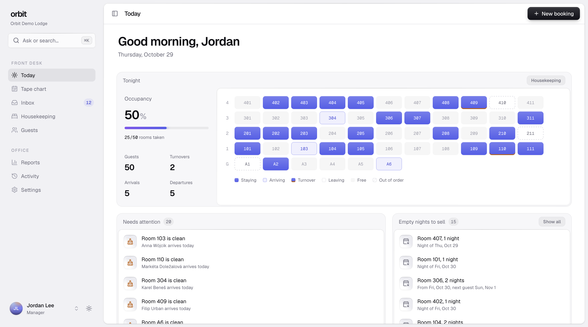
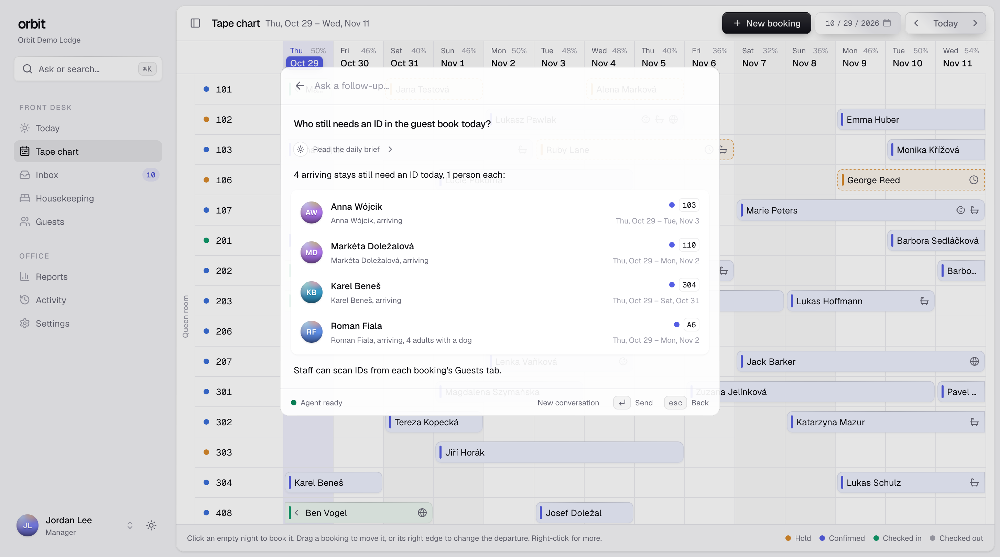
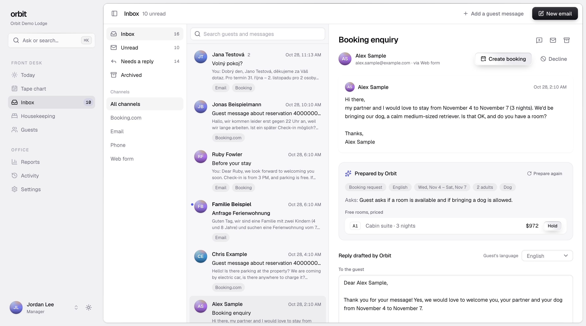
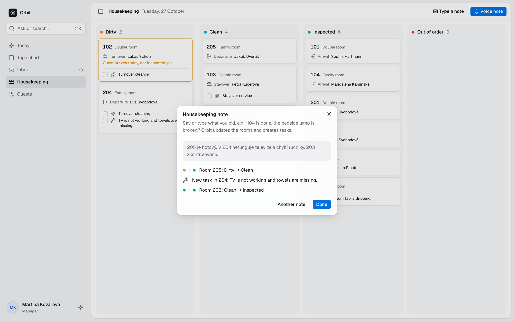
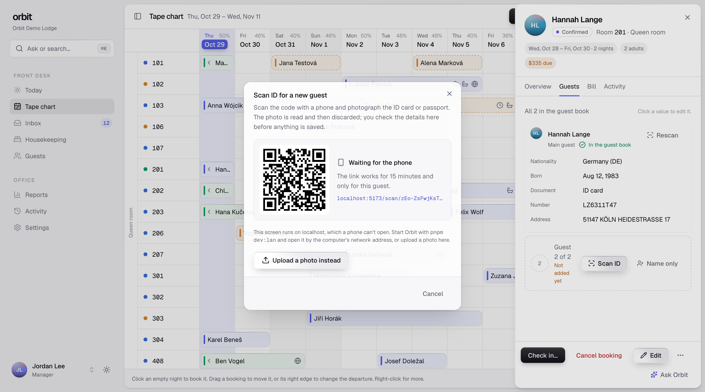
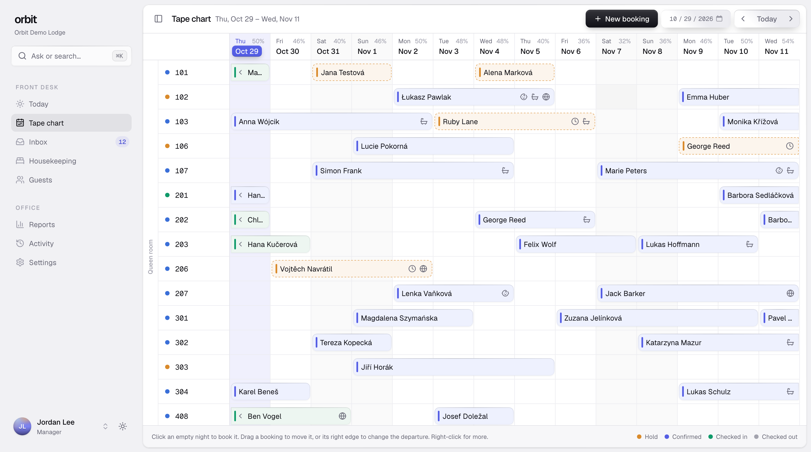
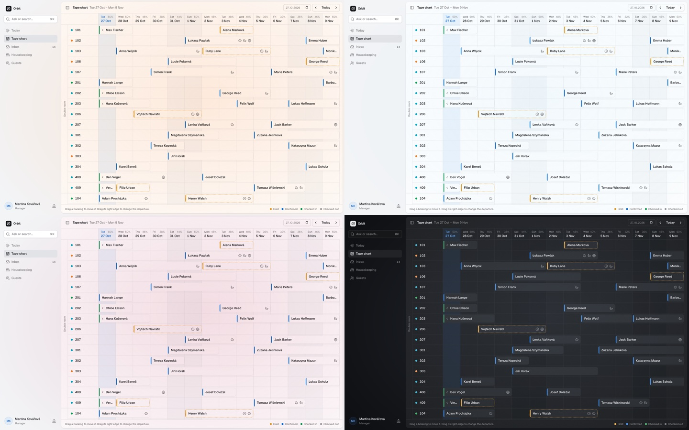
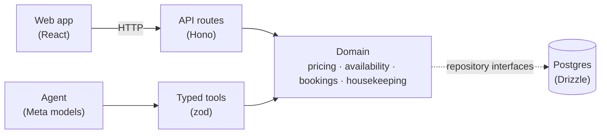

# Orbit PMS

An AI-native property management system for small hotels: anything you can click, you can also just ask for.



**Trying it out:** it runs on your machine in about two minutes with your own Meta API key. See [Run it locally](#run-it-locally).

## Why

I'm the assistant manager at a small wellness guesthouse in the Jizera Mountains in Czechia. A day at the front desk of a place like ours means guest emails in Czech, German, Polish and English, Booking.com messages, per-person prices with child discounts and wellness add-ons, and housekeeping updates passed along by phone or in the corridor. Most hotel software leaves all of that to the person at the desk, and where AI shows up, it's usually a chat window on the side.

The demo runs as a fictional US mountain lodge on Pacific time: room rates in dollars, occupancy and sales tax added on the bill, US dates and an English-speaking team, with guests writing in from all over. The same app runs a Czech guesthouse in crowns, per person, with VAT included: currency, taxes, guest-book rules and time zone are settings ([ADR 0013](docs/decisions/0013-configurable-region-us-demo.md)).

Orbit is built the other way round. One set of hotel rules (availability, pricing, the booking lifecycle, housekeeping) runs everything. The screens call those rules, and so does an agent running on Meta's models, so the agent can do anything the UI can and never invents a price.

## What it does

### Ask anything, from anywhere

Press <kbd>⌘K</kbd> and type what you need, or click the microphone and say it: "is a family room free from Friday?", "move the Schulz booking to 201", "who arrives today?". Spoken questions go through Meta's speech-to-text, listening for the names of the guests in house this fortnight. The agent picks tools, shows each step in plain words, and puts anything that would change a booking on a confirm card. Nothing changes until a person clicks Confirm, and every change lands in the audit log.



### An inbox that drafts the answer, in two languages

Email, web forms, phone notes and Booking.com messages land in one mail client: conversations with their history, folders, channel filters and search. Opening a message costs nothing. When staff click "Draft reply", Orbit reads the conversation, pulls out the dates, party, children's ages and wishes, finds free rooms, prices them with the real pricing rules, and drafts a reply in the guest's language. The reply box opens on the same text in the receptionist's own language, with a tab for the guest's; either can be edited and translated into the other, and only the guest's text is sent. A price guard checks every amount in the draft and its translation against the quote, so a wrong price never reaches a guest. One click puts a hold on a room, another moves it to a different one, and a redraft tells the guest the room is held for them until the hold ends. A team asking for eight rooms gets a block: the domain spreads the party over the cheapest rooms that fit, prices each room, and one click holds them all.



### It remembers your regulars

When a guest comes back, the booking shows what Orbit remembers from their earlier stays: they asked for a quieter room away from the road, their anniversary is tomorrow, they're allergic to feathers, they bring e-bikes. Muse Spark reads the notes staff wrote on earlier stays and the guest's own messages, keeps what helps next time, and leaves out logistics, judgements and anything sensitive. The agent knows it too, and the note before their stay can mention it.

### A note before every stay

The day before guests arrive, Today lists who hasn't heard from the hotel yet. One click drafts a personal email for each, in their own language: the arrival day and check-in time, the forecast when it matters ("snow tomorrow, chains may be needed on the pass"), the spa they booked or the rules for their dog from Knowledge, and the ID to bring. Staff read, edit and send them all at once; each goes out linked to its booking.

### Housekeeping by voice

Housekeepers record a note on their phone, in their own language: "205 je hotový, v 204 nefunguje televize". Meta's speech-to-text transcribes it, the model reads it into room updates, and Orbit sets the room statuses and creates repair tasks. These are low-risk and easy to undo, so they apply straight away and the note shows exactly what changed. The board highlights rooms where a guest arrives today but the room isn't inspected yet, and cards can be dragged between columns. Within the same deadline it puts the heavier cleans first: children, dogs and long stays come from the booking, and Muse Spark reads the booking notes and guest messages for what only the text says ("we're bringing our labrador", "could you set up a cot"), shown as small cues on each card.



### Check-in with a phone scan of the ID

The booking panel keeps the guest book per person. "Scan ID" shows a QR code: a phone on the desk opens it, photographs the ID card or passport, and Meta's vision model reads it into the guest-book fields for staff to check before anything is saved. The photo is read in memory and never stored, and the link works for 15 minutes for that one guest. Check-in doesn't wait for the guest book: stays still missing an ID show up on Today and in the daily brief, and the agent can list them.



### Rates that read the weeks ahead

Rates opens on the next 60 nights: how full each night is against what's usual for that weekday, local events, and the weather forecast for the hotel (Open-Meteo). The domain suggests a change per night from small, labelled rules ("Busier than a usual Friday +10%, Ski area opening weekend +15%"), and a manager takes it, sets another percent, or applies them all, with Undo. Whenever bookings, events, the forecast or the inbox change, Muse Spark reviews the 60 nights at high reasoning for what the rules can't see: a team asking for eight rooms in an email, Thanksgiving week, several requests for the same weekend. It grades each as a slight, moderate or strong signal with its reason, and the domain turns the grade into a percent, so the suggestions move with the hotel while the model never sets a number. Muse Spark summarises the outlook in a few sentences, checked so it states no number the outlook doesn't, and the agent can read it and propose changes ("raise next weekend by the suggested amount"). The same page lists this week's arrivals most likely not to come, from how they booked and the guest's own history, never from who the guest is.

### A tape chart that follows the day

The Mews-style tape chart groups rooms by type. Stays run from midday of the arrival day to midday of the departure day, so on a turnover the leaving and the arriving guest share that day's cell. Drag a booking to another room or other dates, or drag its right edge to change the departure; every drag goes through the same rules as the agent.



The optional daylight theme turns the app light at 06:30 and dark at 19:30, with a soft glow that follows the sky: pink dawn, pale midday, orange-violet sunset, then moonlight.



All guests, bookings and messages in the demo and the screenshots are synthetic. Prices are placeholders.

## How it uses Meta's models

Every AI feature runs on Meta's models through the Vercel AI SDK: Muse Spark on the Meta Model API, and its open-weight sibling Muse Spark Open on Baseten for reply drafts and translations. The models do language, the domain does the facts:

| Feature             | Model                                               | What the model does                                                                               | What it never does                                                             |
| ------------------- | --------------------------------------------------- | ------------------------------------------------------------------------------------------------- | ------------------------------------------------------------------------------ |
| ⌘K agent            | `muse-spark-1.3`                                    | Plans multi-step tool use over 56 typed tools, writes the answer                                  | Computes a price or availability, or changes a booking without a click         |
| Inbox extraction    | `muse-spark-1.3`                                    | Structured output: kind, language, dates, party, rooms, child ages, wishes                        | Picks rooms or prices                                                          |
| Reply drafts        | `muse-spark-open` on Baseten, else `muse-spark-1.3` | Writes the reply in the guest's language around the exact quoted totals                           | Runs before staff ask, or sends a reply; a wrong amount is redone or dropped   |
| Translation         | `muse-spark-open` on Baseten, else `muse-spark-1.3` | Puts drafts and guest messages into the staff member's language and back                          | Changes an amount: such a translation is redone or refused                     |
| Housekeeping notes  | `muse-voice-transcribe-1.0` + `muse-spark-1.3`      | Transcribes the recording, reads it into room/status/issue updates                                | Changes bookings; unknown rooms and forbidden changes are skipped              |
| Notes before a stay | `muse-spark-open` on Baseten, else `muse-spark-1.3` | Writes the email before arrival in the guest's language from the stay, the forecast and Knowledge | Sends it, or states a price the hotel facts don't                              |
| Guest memory        | `muse-spark-1.3`                                    | Reads a returning guest's earlier stays and messages into what to remember                        | Changes a booking, or keeps judgements or sensitive details                    |
| Spoken questions    | `muse-voice-transcribe-1.0`                         | Turns a question asked out loud in ⌘K into text, listening for guests' names                      | Acts on it: the agent answers it like a typed one, with the same confirmations |
| ID scans            | `muse-spark-1.3` (vision)                           | Reads a phone photo of an ID card or passport into guest-book fields                              | Saves them: staff review every value; the photo is never stored                |
| Stay notes          | `muse-spark-1.3`                                    | Reads booking notes and guest messages for pets, mess and things to set up                        | Decides the cleaning order: the domain scores it                               |
| Rate summary        | `muse-spark-1.3`                                    | Writes two or three sentences of advice on the coming nights                                      | Works out a rate: every percent must be one the domain computed                |
| Report summary      | `muse-spark-1.3`                                    | Three sentences on a period against the one before: what moved, why, what to do                   | Works out a figure: every number must be one the domain computed               |
| Rate review         | `muse-spark-1.3`                                    | Finds holidays, group requests and patterns, graded with their reasons                            | Sets a percent: the domain turns each grade into one                           |

Muse Spark always reasons before answering, so the reasoning effort is set per feature to the lowest level that keeps quality, measured with the evals and live runs: `minimal` for extraction, drafts, notes, the rate summary and ID scans, `low` for the agent, which plans multi-step tool use, and `high` for the rate review, which weighs sixty nights, the inbox and the country's holidays together and runs only when the outlook changes.

**Guardrails**

- The model calls `quote` and `checkAvailability` and repeats their results. Tool arguments and model output are validated with zod.
- Booking changes are proposals that run only after a person confirms, with the stored arguments, never ones sent by the browser ([ADR 0004](docs/decisions/0004-human-approval-for-mutations.md)).
- Every change, by staff or agent, is written to the audit log with its actor.
- Every model call is metered in the database against a monthly budget, with per-IP and daily limits on top ([ADR 0006](docs/decisions/0006-agent-autonomy-and-cost-budget.md)).

**Cost, measured with real calls:** an agent question costs about $0.019, a guest message about $0.004, a housekeeping note about $0.002. For a 30-room property that comes to roughly $30 a month.

More in [docs/ai.md](docs/ai.md).

## Evals

`pnpm eval` runs the real models against synthetic fixtures and prints a pass rate, cost and latency per item.

| Suite               | Fixtures                                                                                                                       | Pass rate    |
| ------------------- | ------------------------------------------------------------------------------------------------------------------------------ | ------------ |
| Inbox extraction    | 15 messages in Czech, German, English and Polish, including Booking.com questions about a stay and a team asking for six rooms | 15/15 (100%) |
| Housekeeping notes  | 10 notes in four languages, including spelled-out room numbers, an unknown room and a vague note                               | 10/10 (100%) |
| Stay notes          | 12 stays in five languages: dogs, a cot, an allergy, muddy bikes, and notes that aren't for cleaning                           | 12/12 (100%) |
| ID scans            | 3 synthetic specimen documents: a Czech-style ID card, a German-style passport and a receipt                                   | 3/3 (100%)   |
| Agent tools         | 21 staff requests run through the real agent and tools, checked by their effect                                                | 21/21 (100%) |
| Reply drafts        | 18 replies with real quotes (one a block of rooms for a group), checked by the price guard                                     | 18/18 (100%) |
| Translations        | 4 drafts and guest messages between Czech, German, English and Polish, amounts kept                                            | 4/4 (100%)   |
| Notes before a stay | 5 guests in four languages: snow and a spa, a dog, a family in the rain, a regular, no forecast                                | 5/5 (100%)   |
| Guest memory        | 4 histories: a regular, pure logistics, a sensitive complaint to leave out, repeats to merge                                   | 4/4 (100%)   |
| Rate review         | 3 outlooks: a block of rooms (and a single request to ignore), Thanksgiving, an ordinary fortnight                             | 3/3 (100%)   |

Measured on 2026-10-30 and 2026-10-31 with `muse-spark-1.3`, and Muse Spark Open on Baseten for drafts and translations, at `minimal` reasoning effort except the agent (`low`) and the rate review (`high`, measured 2026-10-31: about 6 s and $0.008 a case). An empty answer from Baseten goes to Muse Spark on the Meta API instead. An inbox message takes about 2 s to read; the whole suite costs about $1.80, most of it the agent.

## Architecture



- **One domain, two callers.** UI actions and agent tools call the same pure, unit-tested domain functions ([ADR 0002](docs/decisions/0002-deterministic-domain-llm-orchestrates.md), [ADR 0003](docs/decisions/0003-shared-tools-for-ui-and-agent.md)).
- **No business logic in the UI, the routes or the prompts.** The domain package has no network, database or env access.
- **The agent lives in the command bar,** not in a chat panel bolted onto the side ([ADR 0007](docs/decisions/0007-command-bar-for-the-agent.md)).
- **The agent knows the property from Settings,** where staff describe policies, amenities and guest information; rules the domain enforces are written into the prompt from code, never retyped ([ADR 0008](docs/decisions/0008-hotel-profile-in-settings.md)).

| Package           | Role                                                     |
| ----------------- | -------------------------------------------------------- |
| `apps/web`        | React UI                                                 |
| `apps/api`        | Hono server: thin routes, SSE for the agent              |
| `packages/domain` | Pricing, availability, bookings, inbox, housekeeping     |
| `packages/db`     | Drizzle schema, migrations, synthetic seed, repositories |
| `packages/ai`     | Meta provider, tools, prompts, price guard, evals        |
| `packages/shared` | zod schemas and types shared by everything               |

Docs: [architecture](docs/architecture.md) · [domain rules](docs/domain.md) · [AI](docs/ai.md) · [API](docs/api.md) · [development](docs/development.md) · [decisions](docs/decisions/)

## Run it locally

Everything runs on your machine: no database, Docker or cloud account to set up. The database is an embedded Postgres ([PGlite](https://pglite.dev)) in a folder of the repo, and the demo hotel is generated with dates around today.

### What you need

- **Node.js 22.12 or newer** (24 recommended; `node -v` to check).
- **pnpm.** Any version from 9 on switches itself to the one this repo pins. Without pnpm: `corepack enable pnpm`, or `npm install -g pnpm`.
- **A Meta Model API key** for the AI features. A Baseten key is optional (see below).

### Start it

```bash
git clone https://github.com/davidkochprg/orbit-pms.git && cd orbit-pms
cp .env.example .env     # then open .env and paste your key after META_API_KEY=
pnpm install
pnpm db:migrate          # creates the embedded database in .data/
pnpm db:seed             # a fictional 50-room lodge, synthetic guests, dates around today
pnpm dev                 # the API on :3001 and the web app on :5173
```

Open **http://localhost:5173** and click **Enter demo**. The API's first log line says `ai: on` when the key was picked up; http://localhost:5173/health lists which AI features are configured.

### A five-minute tour

1. Press <kbd>⌘K</kbd> (<kbd>Ctrl</kbd>+<kbd>K</kbd> on Windows and Linux) and ask "Who arrives today?", then "Raise next Friday's rate by 10%": the change waits on a confirm card.
2. **Inbox**: open a guest message, click **Draft reply**, then **Hold** on one of the rooms it found.
3. **Housekeeping**: **Type a note** such as "205 is clean, the TV in 204 is broken", or record a **Voice note** with a microphone.
4. **Rates**: click the ski-opening weekend to see why it's suggested higher, then **Summarize**.
5. **Tape chart**: drag a booking to another room or other dates.
6. Open a booking, **Scan ID**, then **Upload a photo instead** with one of the synthetic documents in `packages/ai/src/evals/id-documents/`.

### Keys and what they turn on

| Variable in `.env`           | Turns on                                                                                                    |
| ---------------------------- | ----------------------------------------------------------------------------------------------------------- |
| `META_API_KEY`               | Every AI feature. Without it Orbit runs with the AI off and ⌘K says "Agent not configured".                 |
| `META_MODEL_VOICE` (preset)  | Voice notes on the housekeeping board. Typed notes work without it.                                         |
| `META_MODEL_VISION` (preset) | Reading ID scans.                                                                                           |
| `BASETEN_API_KEY` (optional) | Reply drafts and translations on Muse Spark Open, Meta's open-weight model. Without it they use Muse Spark. |

The other values in `.env.example` work as they are. The API never sends the keys to the browser. AI spend is recorded and capped at $50 a month by default (`AI_MONTHLY_BUDGET_USD`).

### If something goes wrong

- **"Agent not configured" or `ai: off`**: `.env` must be at the repo root, next to `package.json`, with the key after `META_API_KEY=`. Restart `pnpm dev` after editing it.
- **A port is in use**: set `PORT` in `.env` for the API (the web app follows it). If 5173 is taken, the web app picks the next free port and prints it.
- **Start over with fresh data**: stop `pnpm dev`, then `pnpm db:reset`. The demo is dated around the day you seed it.
- **Scanning with a real phone**: start with `pnpm dev:lan` and open Orbit by the network address it prints, so a phone on the same Wi-Fi can open the scan link.

More in [docs/development.md](docs/development.md).

## How it was built

A pnpm monorepo in strict TypeScript: Vite, React, Tailwind and shadcn/ui on the front end, Hono on Node for the API, Drizzle on Postgres, and the Vercel AI SDK pointed at the Meta Model API. Design tokens cover light and dark mode and a single accent hue. The domain, AI pipelines and API routes are covered by Vitest tests, and Husky runs typecheck and lint before every commit.

## License

[MIT](LICENSE)
