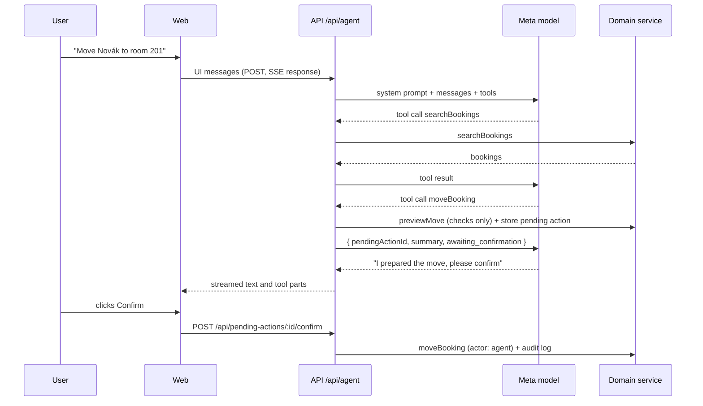

# AI

The agent operates the hotel through the same domain service as the UI. It understands the request, picks tools and writes the reply. Prices, availability and every change come from `packages/domain`.

## Agent loop

`runAgent` (`packages/ai/src/agent.ts`) calls the AI SDK's `streamText` with the tools, stopping after at most 8 model calls per user message. `POST /api/agent` validates the incoming UI messages, converts them for the model and streams the result back as an AI SDK UI message stream (server-sent events).

## Tools

Defined in `packages/ai/src/tools.ts` with zod input schemas from `packages/shared`. Each is a thin wrapper over the domain service. Domain errors are returned to the model as `{ error: { code, message } }` so it can explain them and try something else.

| Tool                              | Does                                                 | Side effect |
| --------------------------------- | ---------------------------------------------------- | ----------- |
| `listRooms`                       | Rooms with IDs, kind, type, status                   | none        |
| `searchBookings`                  | By guest name (accents ignored), room, dates, status | none        |
| `getBooking`                      | Booking detail with price breakdown                  | none        |
| `checkAvailability`               | Free rooms that fit the party, cheapest first        | none        |
| `quote`                           | Line-item price for a room or room type              | none        |
| `getArrivals`, `getDepartures`    | For a date, default today                            | none        |
| `createHold`                      | Hold for a new or existing guest                     | proposal    |
| `confirmBooking`, `cancelBooking` | Status change                                        | proposal    |
| `moveBooking`                     | Same dates, another room                             | proposal    |
| `changeDates`                     | New dates, same room, re-priced                      | proposal    |

## Approval pattern

See [ADR 0004](decisions/0004-human-approval-for-mutations.md). A proposal tool:

1. Runs the domain operation's `preview*` function, which applies every rule against current data without saving. An invalid change fails here and the model hears why.
2. Stores a `PendingAction` with the exact arguments and a one-line summary, e.g. `Move Tomáš Novák (2026-10-27 to 2026-10-29 (2 nights)) from room 104 to room 201`.
3. Returns `{ pendingActionId, summary, status: 'awaiting_confirmation' }`.

The UI shows a confirm card. `POST /api/pending-actions/:id/confirm` runs the stored arguments (never ones sent by the browser) through the domain service with actor `agent`, writing the audit log. If the data changed in the meantime and the action is no longer valid, it is marked `failed` with the reason. Each action can be resolved once.

## Prompts

`packages/ai/src/prompts/system.ts` builds the system prompt from a `HotelProfile` (`packages/ai/src/hotel.ts`: name, location, check-in and check-out times, policies), today's date and the hotel timezone. The prompt tells the model to use tools for every fact, never to compute prices or availability, and that changes are proposals.

## Evals

`packages/ai/src/evals/inquiries.ts` holds ten synthetic inquiries (Czech, German, English, Polish), dated relative to today, each with its expected extraction: language, dates, adults, child ages, and wishes (wellness, dog, apartment). The demo seed uses the same inquiries.

`scoreExtraction(expected, actual)` scores an extraction by exact match on those fields; child age order and guest name are ignored. `pnpm eval` currently only loads the fixtures, because there is no extractor yet.

## Meta models

The Meta Model API is OpenAI-compatible, so `packages/ai/src/provider.ts` wraps the AI SDK's `@ai-sdk/openai-compatible` provider pointed at `META_API_BASE_URL`. `apps/api` builds it from env vars and turns AI off when `META_API_KEY` or `META_MODEL_AGENT` is missing.

| Env var             | Model (from the Meta Model API docs) | Used for                                                                                    |
| ------------------- | ------------------------------------ | ------------------------------------------------------------------------------------------- |
| `META_MODEL_AGENT`  | `muse-spark-1.3`                     | Agent loop and tool calling (Chat Completions)                                              |
| `META_MODEL_VISION` | `muse-spark-1.3` (accepts images)    | Not wired yet                                                                               |
| `META_MODEL_VOICE`  | `muse-voice-transcribe-1.0`          | Not wired yet; uses Meta's own `/v1/asr/transcribe` endpoint, not the OpenAI-compatible one |

Constraints from Meta's tool-calling docs that the agent respects: `tool_choice` only accepts `"auto"` (the SDK default), and tool arguments are not guaranteed to match the schema, so the SDK validates them with the zod schemas.

## Rate limits

The public demo is protected in `apps/api/src/limits.ts` (in memory, reset on restart):

- `AI_RATE_LIMIT_PER_HOUR` agent requests per client IP per rolling hour (IP from `x-forwarded-for`).
- `AI_DAILY_TOKEN_BUDGET` tokens per UTC day across all visitors, counted from model usage after each turn.

When a limit is hit, `POST /api/agent` returns 429 `demo_limit` with a message the agent panel can show as is.
