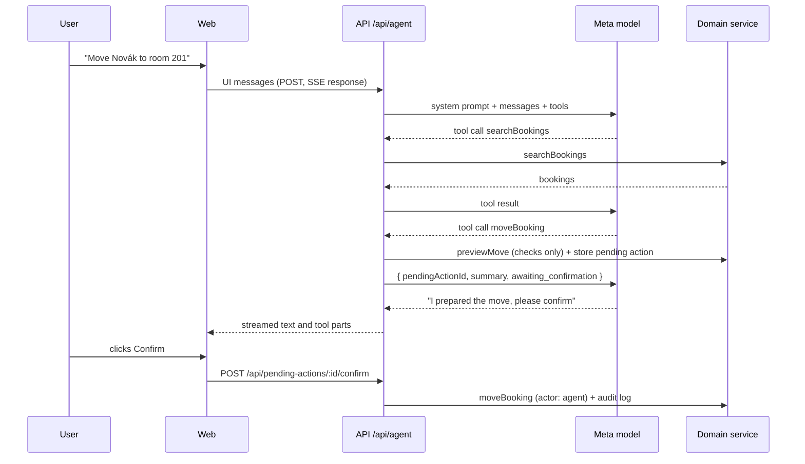
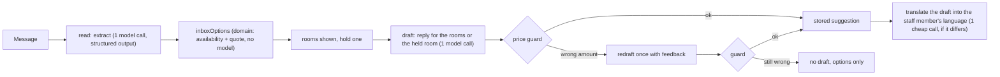

# AI

The agent operates the hotel through the same domain service as the UI. It understands the request, picks tools and writes the reply. Prices, availability and every change come from `packages/domain`.

## Agent loop

Staff talk to the agent in the ⌘K command bar. Answers are structured ([ADR 0011](decisions/0011-structured-agent-answers.md)): the agent writes bookings, rooms, guests and inbox conversations as `[[bk_147]]`-style tokens, which the thread renders as chips, and as rows when a list item leads with one: a booking opens in the inspector and has its right-click menu, a room opens a menu with its type and status, a new booking in it, the tape chart and housekeeping, a conversation opens in the inbox (`components/agent-thread.tsx`, `components/agent-mention.tsx`, `lib/agent-answer.ts`); what some tools return appears as cards built from the tool output (see [Result cards](#result-cards)); proposed changes appear as confirm cards. In agent mode the bar is wider and a fixed height, the input sits under the conversation, and each new question scrolls to the top so its answer is read from the start. The steps of an answer fold into one line ("Checked arrivals and opened the bill") that opens into a timeline with a short result per step and the raw tool input and output one more click away. While the agent works, a thinking orb (`thinking-orbs`) shows the current step and a beam (`border-beam`) runs round the bar. Questions carry what the staff member is looking at: the open booking, a guest profile or an inbox conversation, shown as a chip in the input that can be removed and above the question once sent. Only its kind and ID go to the server, which writes the note the model reads (`prompts/context.ts`), with the ID as a token, so "when do they leave?" works from a booking and "reply to them" from a conversation. A booking opened from the conversation shows in the inspector while the bar steps aside, and the conversation comes back when the inspector closes. The booking inspector's "Ask Orbit" button opens the bar with that booking as the context. The conversation stays in memory until the page reloads or the user starts a new one.

### Asking out loud

When a voice model is configured (`META_MODEL_VOICE`) and the browser can record, the command bar has a microphone next to its input, in search and in the conversation. Clicking it records (up to a minute, the input showing "Listening…" and the time); clicking again stops, and Escape drops the recording. `POST /api/agent/transcribe` transcribes it with `muse-voice-transcribe-1.0` (`createSpeechInput`, `packages/ai/src/speech.ts`), biased toward the words a speech model would get wrong (`speechKeywords`): the names of guests staying from yesterday to two weeks out, then room names that aren't plain numbers, at most 100. The text is then asked exactly like a typed question, so the answer, the cards and every confirmation are the same. The audio is not stored; its seconds are recorded as `agent_voice`.

### Follow-ups

After an answer, up to three next steps sit above the input (`lib/agent-follow-ups.ts`). They are worked out from the tool results, not by the model: after the brief, the rooms still to prepare, who needs an ID and the inbox; after free rooms, the weekend after; after a report, the period before and the booking sources; after a bill with money due, recording it as a card payment; after arrivals, who needs an ID and whose room isn't ready. A question is sent as the next message; a page opens and the bar closes.

### Result cards

`components/agent-result-cards.tsx` turns finished tool steps into cards under the answer. Amounts come straight from the tool output, never from the model's text.

| Tool                                                       | Card                                                                                                                                                                                                                                                                                             |
| ---------------------------------------------------------- | ------------------------------------------------------------------------------------------------------------------------------------------------------------------------------------------------------------------------------------------------------------------------------------------------ |
| `getReport`                                                | Occupancy, ADR, RevPAR and room revenue with a bar per night. When the agent also ran the period just before, as it does to compare, the two make one card with the change against it                                                                                                            |
| `getDailyBrief`                                            | Tonight's occupancy, guests, arrivals and departures, then what needs attention as on Today, each row opening where it is handled                                                                                                                                                                |
| `getArrivals`, `getDepartures`, `searchBookings`           | The bookings as rows that open the booking, five at first. Shown only when the answer doesn't list them as booking rows itself and proposes no change, so they never appear twice; left out when another card shows what the agent was looking for, e.g. the guest book of today's first arrival |
| `getGuestBook`                                             | The booking's guest book as it is now, one row per person with what is still needed and a Scan ID button that opens the phone scan from the inspector; people not added yet get a row only where the region records everyone                                                                     |
| `checkAvailability`                                        | Free rooms with their totals; a row opens into the line items, and Hold opens a new booking with the room, stay, party and add-ons filled in                                                                                                                                                     |
| `quote`                                                    | The quote's line items and total                                                                                                                                                                                                                                                                 |
| `getBill`                                                  | The latest bill of each booking: charged, extras, paid and the balance, with a button to open the booking                                                                                                                                                                                        |
| `setRoomStatus`, `createHousekeepingTask`, `setTaskStatus` | What the agent changed, one row per room: old → new status, or the new task. A status change has a button that sets it back, through the same endpoints as the board. A created task can't be undone from the card; it has a link to Housekeeping                                                |
| `getRepair`                                                | Who can fix a repair, live: the room, its trade and when it is free, each contact with a call link and an Email button that drafts the email, as on the housekeeping board                                                                                                                       |

`runAgent` (`packages/ai/src/agent.ts`) calls the AI SDK's `streamText` with the tools, stopping after at most 8 model calls per user message. `smoothStream` releases the text word by word (20 ms apart), however the provider batches it; the command bar shows result and confirm cards only once the reply has finished, below the text. `POST /api/agent` validates the incoming UI messages, converts them for the model and streams the result back as an AI SDK UI message stream (server-sent events).

## Tools

Defined in `packages/ai/src/tools.ts` with zod input schemas from `packages/shared`. Each is a thin wrapper over the domain service. Domain errors are returned to the model as `{ error: { code, message } }` so it can explain them and try something else.

| Tool                                                       | Does                                                                                                                                                                                                                                                  | Side effect |
| ---------------------------------------------------------- | ----------------------------------------------------------------------------------------------------------------------------------------------------------------------------------------------------------------------------------------------------- | ----------- |
| `listRooms`                                                | Rooms with IDs, kind, type, status                                                                                                                                                                                                                    | none        |
| `searchBookings`                                           | By guest name (accents ignored), room, dates, status                                                                                                                                                                                                  | none        |
| `getBooking`                                               | Booking detail with price breakdown                                                                                                                                                                                                                   | none        |
| `checkAvailability`                                        | Free rooms that fit the party, cheapest first, each with its quote (`roomOptions`); the model sees only each room's total                                                                                                                             | none        |
| `quote`                                                    | Line-item price for a room or room type                                                                                                                                                                                                               | none        |
| `getArrivals`, `getDepartures`                             | For a date, default today                                                                                                                                                                                                                             | none        |
| `getDailyBrief`                                            | The day's brief (see [domain.md](domain.md#daily-brief))                                                                                                                                                                                              | none        |
| `createHold`                                               | Hold for a new or existing guest                                                                                                                                                                                                                      | proposal    |
| `confirmBooking`, `cancelBooking`                          | Status change                                                                                                                                                                                                                                         | proposal    |
| `checkIn`, `checkOut`                                      | The check-in summary says how many guests still need an ID; the check-out summary says what is still due                                                                                                                                              | proposal    |
| `moveBooking`                                              | Same dates, another room                                                                                                                                                                                                                              | proposal    |
| `changeDates`                                              | New dates, same room, re-priced                                                                                                                                                                                                                       | proposal    |
| `updateBooking`                                            | Party, add-ons, source, notes, and room and dates, in one step; re-priced when the stay changes                                                                                                                                                       | proposal    |
| `getReport`                                                | Occupancy, ADR, RevPAR, revenue, sources, room types, payments and unpaid departures for a period; the daily series goes to the app's chart, not to the model                                                                                         | none        |
| `getBill`                                                  | A booking's bill: stay lines, city tax, extras, payments, balance                                                                                                                                                                                     | none        |
| `addCharge`                                                | Post an extra at the price and tax bracket the staff member gives; the summary shows the balance after                                                                                                                                                | proposal    |
| `recordPayment`                                            | Payment or refund by cash, card or bank transfer; the summary shows the balance after                                                                                                                                                                 | proposal    |
| `updateCharge`, `removeCharge`                             | Correct or remove an extra on a bill (chargeId from `getBill`); the summary shows the balance after                                                                                                                                                   | proposal    |
| `getGuestBook`                                             | Everyone in a booking's room and what each still needs. Document numbers and addresses are left out; the model only sees whether they are recorded                                                                                                    | none        |
| `addToGuestBook`, `updateGuestBook`, `removeFromGuestBook` | Add a companion, record or correct a person's ID details, take a companion off; the summary shows the values                                                                                                                                          | proposal    |
| `updateGuestProfile`                                       | A guest's name, email, phone, language or notes                                                                                                                                                                                                       | proposal    |
| `getHousekeeping`                                          | Today's housekeeping board in cleaning order: room status, occupancy, guest, urgency, cleaning effort with its cues, and open tasks                                                                                                                   | none        |
| `setRoomStatus`, `createHousekeepingTask`, `setTaskStatus` | Room status, a new maintenance (with its trade) or cleaning task, a task's progress; status changes return the status before (`from`), and for out of order the stays to move with a free room each (`relocations`), which the model proposes to move | direct      |
| `getRateOutlook`                                           | The next nights (7 to 90): occupancy against the usual for the weekday, current and suggested rate change with reasons, events, weather, expected no-shows, and this week's riskiest arrivals. Percents come as text to repeat                        | none        |
| `adjustRates`                                              | Set nights' rates to a percent on top of the season, 0 for the season rate; the summary lists each night's old and new percent                                                                                                                        | proposal    |
| `saveHotelInfo`                                            | Save a note or a temporary notice (with its last day) in Knowledge, in a folder with a few tags; a note with the same title is replaced, a notice gets its own title                                                                                  | proposal    |
| `removeHotelInfo`                                          | Delete a note from Knowledge by its title                                                                                                                                                                                                             | proposal    |
| `listConversations`                                        | Conversations in a folder (inbox, starred, needs a reply, sent, archive or trash) or with a label, latest first, optionally unread only or matching a name or words: sender, request, status, star, labels and the start of the last message          | none        |
| `getConversation`                                          | One conversation: every message, the request as read, the rooms on offer with their totals, and the current draft                                                                                                                                     | none        |
| `draftReply`                                               | The inbox pipeline's reply draft for a conversation, with rooms free now and their exact prices checked by the price guard; staff also see it in the inbox                                                                                            | model call  |
| `sendReply`                                                | Send a reply in a conversation, signed by the staff member who confirms. Refused before proposing if it states an amount that no quote for the conversation produced (its room options or draft) and the hotel facts don't state                      | proposal    |
| `holdFromConversation`                                     | Hold a room from a conversation's room options for the stay it asks for, linked to the conversation; an existing hold moves. Without a room, every room of the conversation's block for a group, in one confirmation                                  | proposal    |
| `getArrivalNotes`                                          | Guests arriving on a day (tomorrow by default) with a confirmed stay and an email who haven't heard from the hotel about it                                                                                                                           | none        |
| `draftArrivalNote`                                         | The note before a booking's stay in the guest's language, from the stay, the forecast, Knowledge and the ID rule ([below](#notes-before-a-stay))                                                                                                      | model call  |
| `sendArrivalNote`                                          | Send that note to the guest who booked, linked to the booking. Refused before proposing if it states an amount the hotel facts don't                                                                                                                  | proposal    |
| `declineConversation`                                      | Mark a conversation's request declined; nothing is sent                                                                                                                                                                                               | proposal    |
| `getActivity`                                              | Who changed what and when, newest first, optionally for one booking, guest, room or conversation, or the agent's own changes                                                                                                                          | none        |
| `getGuest`                                                 | A guest's profile, every stay they booked, newest first, and what Orbit remembers from their earlier stays                                                                                                                                            | none        |
| `getLocalEvents`                                           | Local events on the rate outlook, with IDs                                                                                                                                                                                                            | none        |
| `addLocalEvent`, `removeLocalEvent`                        | Add or remove a local event; a manager must confirm                                                                                                                                                                                                   | proposal    |
| `updateRoom`                                               | Rename a room or change its type, kind or floor; only the fields that change are shown; a manager must confirm                                                                                                                                        | proposal    |
| `listContacts`                                             | Suppliers and contractors with what they do, phone, email and notes, optionally for one trade                                                                                                                                                         | none        |
| `getRepair`                                                | A repair with the contacts for its trade (the one asked last time first), who was asked, and when the room is free to work in                                                                                                                         | none        |
| `recordRepairContact`                                      | Record that staff asked a contact to fix a repair; the task moves to in progress                                                                                                                                                                      | direct      |
| `saveContact`, `removeContact`                             | Add a contact, change only the fields given, or delete one                                                                                                                                                                                            | proposal    |
| `organizeConversations`                                    | Archive or unarchive, trash or restore, mark read or unread, star or unstar, label or unlabel conversations                                                                                                                                           | direct      |

"Direct" tools change data straight away, logged in the audit log with actor `agent`: room status, housekeeping tasks, who was asked to fix a repair and filing conversations are low-risk and reversible ([ADR 0006](decisions/0006-agent-autonomy-and-cost-budget.md)), the same rule as for voice notes. Everything else that changes data is a proposal.

## Approval pattern

See [ADR 0004](decisions/0004-human-approval-for-mutations.md). A proposal tool:

1. Runs the domain operation's `preview*` function, which applies every rule against current data without saving. An invalid change fails here and the model hears why.
2. Stores a `PendingAction` with the exact arguments, a one-line summary for the model, e.g. `Move Tomáš Novák (2026-10-27 to 2026-10-29 (2 nights)) from room 104 to room 201`, and `details` for the confirm card: one row per thing that changes with its value before and after (Room 104 → 201), the stay total or bill balance before and after, and a note such as IDs still missing.
3. Returns `{ pendingActionId, summary, status: 'awaiting_confirmation' }`.

The UI shows a confirm card (`components/pending-action-card.tsx`): what kind of change it is, the booking it concerns as a row, the changed values with the old one struck through, the money it moves, and Confirm and Reject. Values are as they were when the change was proposed; each card's balance assumes only its own change, so after confirming two bill changes the balance is the result of both. When one answer proposes several changes, "Confirm all" confirms those still waiting, one after another. From the keyboard, ⌘↵ confirms the newest change still waiting and ⌘⌫ (with an empty input) rejects it; that card is outlined and its buttons show the shortcuts. `POST /api/pending-actions/:id/confirm` runs the stored arguments (never ones sent by the browser) through the domain service with actor `agent`, writing the audit log. The staff member signed in on the browser that confirms (`x-staff-id`) is passed along: a reply is signed with their name, and changes only managers may make (local events, rooms) fail unless they are an active manager. If the data changed in the meantime and the action is no longer valid, it is marked `failed` with the reason. Each action can be resolved once: confirming claims it with a conditional update first, so two clicks at the same time run the change only once.

## Inbox pipeline

A conversation is prepared only when staff click "Prepare reply" ([ADR 0012](decisions/0012-inbox-conversations-and-ai-on-request.md)); opening one never calls a model (`packages/ai/src/inbox.ts`). Preparing runs in two steps ([ADR 0016](decisions/0016-inbox-rooms-first-reply-follows-the-hold.md)): `read` extracts the request and finds its rooms, which show at once, then `draft` writes the reply from that reading and the room staff hold now. Holding a room drafts again, so the reply tells the guest the room is held; if staff have edited the reply, the reply box asks first ("Rewrite for room 104"). The model reads the whole conversation, oldest message first, and answers the guest's latest message. The reading is stored until the guest writes again, so drafting again doesn't read the request again.

1. **Extract**: `generateText` with `Output.object(inquiryExtractionSchema)` (Meta `response_format: json_schema`, `strictJsonSchema: false` because strict mode only adds a server check that may reject keywords zod emits). Classifies the message (`booking_request`, `question`, `other`), its language, stay, party, how many rooms it asks for (`rooms`, for a group) and wishes.
2. **Options** (no model): for a complete booking request, `hotel.inboxOptions` finds free rooms (an apartment if asked for, or if a dog comes, per `hotelPolicy.dogsAllowedIn`) and quotes up to three, one per room type, with wished add-ons. If staff already hold a room for the message, that room leads the options at its quoted price (it is no longer free), and the draft presents it alone: held for the guest until the hold ends (`holdExpiry`, in the hotel's time zone and clock), asking them to confirm. A group that asks for several rooms, or doesn't fit one, gets a **block** instead ([domain.md](domain.md#inbox)): the rooms with who sleeps where, a subtotal per room type and the total. The inbox shows it with "Hold all", which holds every room at once; the draft then says the rooms are held until the first hold ends.
3. **Draft**: rooms are looked up again, so the draft offers what is free now. The model (Muse Spark Open when Baseten is configured, see [below](#muse-spark-open-on-baseten)) writes a plain-text reply in the guest's language, given the exact totals as text in the hotel's currency (e.g. `$1,156` or `12 500 CZK`). For a block it gets the total, the subtotal per room type and each room's share and price (`blockOffer`), and states the total and the subtotals without listing every room. It offers no discount or group rate the facts don't state: asked for one, it gives the prices and says it will check with the manager. When taxes are added on the bill it says so, without working them out. It greets guests by the name they signed with, never a guessed title.
4. **Price guard** (`price-guard.ts`): every money amount in the draft must be one of the quoted totals, line amounts or unit prices, a block's total or subtotal, or an amount the hotel profile states, and every option's total (or the block's total) must appear. Czech, German, Polish and English number formats are recognised. A failing draft is regenerated once; if it fails again, no draft is shown, so a wrong price never reaches a guest.

5. **In the staff's language** (`translate.ts`): when the staff member who asked reads another language than the guest writes, the draft is translated into theirs (`draftTranslation`). The reply box opens on that version with a tab for the guest's; staff edit either and translate it into the other, only the guest's text is sent, and sending waits until edits in the staff's language are translated.

The pipeline checks the monthly budget before calling the model and records `inbox_extract`, `inbox_draft` and `translate` usage separately. Errors are stored on the conversation (`processingError`) and the next request retries.

### Translation

`createTranslator` (`packages/ai/src/translate.ts`) translates guest messages into the reader's language and reply texts both ways, only when staff ask. It runs on Muse Spark Open when Baseten is configured, otherwise on `META_MODEL_TRANSLATE` (the agent model when unset; Meta has no cheaper Standard-tier text model yet), at `minimal` reasoning. The prompt keeps names, dates, room numbers and every amount with its currency as written; `sameAmounts` checks that the translation states the same amounts as the source, and one that doesn't is redone once and otherwise refused (`translation_failed`). A guest message's translation is stored with the message. A translation costs about $0.002.

## Housekeeping notes

A housekeeper records a voice note ("room 104 done, the bedside lamp is broken") or types one. `createHousekeepingNotePipeline` (`packages/ai/src/housekeeping.ts`):

1. **Transcribe** with `muse-voice-transcribe-1.0` (`transcribeWav`, `packages/ai/src/transcribe.ts`). Meta's `POST /asr/transcribe` is not OpenAI-compatible: a multipart body with a JSON `request` part (`model`, `audioEncoding: "WAV"`, `mode: "PUSH_TO_TALK"`, `keywords`) and an `audio` part holding mono 16-bit PCM WAV at 16 kHz. The room names are sent as `keywords` to bias recognition. The browser records and converts to that format.
2. **Read** the transcript into `{ updates: [{ room, status, issue, trade }], unclear }` with one structured-output call, given the list of room names. Spoken numbers count ("sto dva" is 102); issues come back as short English sentences with the trade that fixes them. A missing or unknown trade reads as null rather than failing the note.
3. **Apply** in the domain as the agent, without a confirm card: room status and maintenance tasks are low-risk and reversible ([ADR 0006](decisions/0006-agent-autonomy-and-cost-budget.md)). The domain matches room names and skips unknown rooms or forbidden changes with a reason. Every change is in the audit log.

Usage is recorded under the `voice` feature: audio seconds for the transcription, tokens for the reading.

## Repairs

`createRepairDesk` (`packages/ai/src/repairs.ts`, prompts in `prompts/repairs.ts`), recorded as feature `repairs`:

- **Trade**: a repair added by hand without a trade is sorted into one (`readTrade`, one structured call at `minimal` on Muse Spark). Repairs from housekeeping notes get theirs in the same call that reads the note; the agent passes one when it logs a repair. Who to ask is then plain domain logic ([domain.md](domain.md#contacts-and-repairs)).
- **Email**: `draftWorkOrder` writes the email asking a contact to come, on the draft model (Muse Spark Open on Baseten, falling back to Muse Spark), in the contact's language. It gets the room, the problem, when the room is free (with weekdays and the check-out and check-in times) and the signer, never the guest's name, and answers with a subject line and the body. Staff edit it and open it in their own mail app; Orbit sends nothing. Calling or opening the email records the contact as asked.

## Notes before a stay

The day before guests arrive, Today's "Needs attention" lists the confirmed arrivals whose guest has an email address and hasn't heard from the hotel about the stay ([domain.md](domain.md#notes-before-a-stay)): "Welcome 6 guests arriving tomorrow". The row opens them in a dialog, one per guest with their language, room and party. "Draft" (or "Draft all", three at a time) asks `POST /api/arrival-notes/:bookingId/draft`, and `createArrivalNoteWriter` (`packages/ai/src/arrival-notes.ts`, prompt in `prompts/arrival-notes.ts`) writes the email on the draft model (Muse Spark Open on Baseten, falling back to Muse Spark) in the guest's language. It gets the hotel facts block, the stay with weekdays and the check-in and check-out times, the party, what was booked (wellness, a dog, an extra bed), the forecast for the arrival day from Open-Meteo, who must show an ID under the region's guest-book rules, and the signer, and writes a greeting by name, the arrival day and time, one or two things from Knowledge that fit the stay (parking, the spa, the rules for a dog, what there is for children), the weather when it matters, what to bring for check-in and an invitation to reply. It answers with a subject line and the body (`parseWorkOrder`).

`arrivalNoteProblems` refuses a note with no subject, Markdown, or an amount of money the hotel facts don't state; such a note is written once more with the reason, then refused (`draft_failed`). Staff read and edit each note, then send it alone or all at once: it goes out as an email conversation linked to the booking, so the stay no longer counts as due and the conversation opens the booking. Nothing is sent without a click. One call at `minimal` reasoning, recorded as `arrival_note`; about $0.0045 a note and 4 s.

## Cleaning effort

The housekeeping board ranks rooms with the same deadline by how much work they are ([domain.md](domain.md#housekeeping)). Children, booked dogs, extra beds and the length of stay come from the booking; the model adds what only the text says: a dog mentioned in a message but not booked, muddy gear or a celebration, a cot or feather-free bedding to set up. `createStayNotesReader` (`packages/ai/src/stay-notes.ts`) sends the board's unread stays, at most 12 per call, in one structured-output call (`stayReadingsSchema`, prompt in `prompts/stay-notes.ts`) and keeps the readings. It changes no booking or room, only what the board shows, so it needs no confirmation and is not in the audit log.

The board asks for it by itself: when `unreadStays` is above zero and AI is configured, the page calls `POST /api/housekeeping/read-stays` in the background and shows the re-ranked board. A stay is read once per version of its text, so an unchanged board costs nothing. Usage is recorded under `stay_notes`, at `minimal` reasoning; a call costs about $0.0015 (the eval average).

## Rate outlook

Suggested rates are computed by the domain from occupancy, the usual demand for the weekday, local events, the weather forecast and the signals of the model's review ([domain.md](domain.md#rate-outlook), [ADR 0017](decisions/0017-rate-suggestions-from-domain-rules.md), [ADR 0022](decisions/0022-model-review-grades-rate-signals.md)); the model never works out a rate. It reviews, reads and explains them:

- **Review**: `createRateReviewer` (`packages/ai/src/revenue-review.ts`, prompt in `prompts/revenue.ts`) gives the model the 60 nights as the rules see them (rooms booked, the weekday's usual, the rules that apply, the weather), the local events, the hotel's name, location and country, and the latest guest message of up to 20 open requests (`openInquiries`: not archived, trashed, declined or booked, and not a question about a stay). It returns at most 8 signals (`rateReviewOutputSchema`): a run of nights, up or down, `slight` | `moderate` | `strong`, a short label and a one-sentence reason. It looks for what the rules can't see: public and school holidays in the hotel's country, requests that add up to a block of rooms, weighed against the hotel's size, and patterns across nights. A signal whose label or reason states a percent or a price is dropped; the domain turns the strength into a percent and cuts signals to the reviewed nights. One call at `high` reasoning, the only feature above `low`: it weighs messages, holidays and sixty nights together and runs only when the outlook changes. Recorded under `rate_review`; about 25 s and $0.01–0.03 a review.
- **When it runs**: the Rates page asks for a review (`POST /api/revenue/review`) whenever the outlook's `review.current` is false, i.e. the fingerprint of what a review reads (`reviewBasis`: the nights as the rules see them, events, open requests, the hotel and today) differs from the stored review's. A new booking, event, request or forecast, or a new day, makes the next visit review again; rate changes by a manager don't. The page shows "Reviewing 60 nights…" meanwhile, and the suggestions that change pop in. The stored review's signals keep counting until the next one replaces them, for the agent too.

- **Summary** on the Rates page (Summarize, above the calendar): `createRevenueBriefWriter` (`packages/ai/src/revenue-brief.ts`) gives the model the notable nights (a suggested change, an event, demand out of the usual, or likely no-shows) and asks for two or three sentences of advice (`prompts/revenue.ts`). Every percent in the text must be one the outlook states (`unknownPercents`); otherwise it is written again once, then refused. On request only, at `minimal` reasoning, recorded under `rate_brief`; about $0.007 a summary.
- **Agent**: `getRateOutlook` returns the outlook with percents as text to repeat, and `adjustRates` proposes per-night changes that run when someone confirms them. "Raise next weekend by the suggested amount" reads the outlook, then proposes.

## Guest memory

Orbit remembers returning guests. The booking inspector and the guest profile show "From earlier stays": at most five short English items, each a `preference` (a quiet room, the ground floor), an `occasion` (an anniversary with its date), a `care` need (a feather allergy, a vegetarian breakfast) or a `habit` (comes with e-bikes). When a guest's history changed since it was last read ([domain.md](domain.md#guest-memory)), the panel asks `POST /api/guests/:id/memory/read` in the background, and `createGuestMemoryReader` (`packages/ai/src/guest-memory.ts`, prompt in `prompts/guest-memory.ts`) reads it in one structured-output call (`guestMemoryReadingSchema`). The prompt keeps only what helps a next stay, merges what repeats, and leaves out one-off logistics (arrival times, invoices, payment, returned property), judgements, nationality, religion, politics, money trouble and complaints about other guests. `tidyMemory` drops empty, overlong and repeated items and keeps five. It changes nothing a guest booked, only what staff see, so it needs no confirmation and is not in the audit log. One call at `minimal` reasoning, recorded as `guest_memory`; about $0.002 a guest, and nothing while the history is unchanged.

What is remembered is used in two more places, each reading the history first when it changed: the agent's `getGuest` returns it (`remembered`), and the note before a stay gets it, so a returning guest's email can mention one thing the team has noted ("we have noted your feather allergy"), never as a promise of a room or a gift.

## Report summary

Reports has a Summarize button beside the period. `POST /api/reports/summary` reads the period's report and the same number of nights before it, and `createReportSummaryWriter` (`packages/ai/src/report-summary.ts`, prompt in `prompts/report-summary.ts`) asks for three short sentences for the manager: the headline against the period before, the one or two things that explain it, and one practical thing to do. The model works nothing out: `reportFacts` turns both reports into lines of facts with every figure already computed (occupancy in points, ADR, RevPAR and revenue changes in percent, each source's share of room nights and its change, room types by occupancy, average occupancy by weekday, the busiest and quietest night, and what departed guests still owe), with nights written as "Fri, Oct 16" and a note when the nights are still ahead. `unknownNumbers` then refuses any number in the summary that the facts don't state, thousands separators ignored; such a summary is written once more with the numbers named, then refused (`summary_failed`). On request only, at `minimal` reasoning on Muse Spark, recorded as `report_summary`; about $0.002 and 4 s a summary.

## ID scans

Staff scan a guest's ID card or passport with a phone at check-in, or later when it was missing ([domain.md](domain.md#id-scans)). The desk shows a QR code for a 15-minute link; the phone photographs the document and the browser re-encodes it as a JPEG of at most 1600 px. `readIdDocument` (`packages/ai/src/id-scan.ts`) sends it to `META_MODEL_VISION` as a file part in one structured-output call (`idDocumentReadingSchema`): whether an ID is readable, its type, the name as printed, nationality as ISO alpha-2, dates as `YYYY-MM-DD`, the document number and an address if printed. The prompt (`prompts/id-scan.ts`) says to copy, never guess, and to check dates against the machine-readable zone.

The domain checks every value before staff see it and turns problems (an expired document, a different name than the booking's) into warnings. Staff review and correct the values on the desk and save them; the model never writes to the guest book. The photo exists only in memory for the one call. Usage is recorded under `id_scan`, at `minimal` reasoning effort.

## Learning from replies

When staff send a reply they wrote or edited themselves, the inbox asks `POST /api/inbox/:id/learn` whether it states a fact about the hotel that the information lacks (`packages/ai/src/learn.ts`, prompt in `prompts/learn.ts`). One model call reads the guest's latest message, the reply and the current entries, and returns at most one fact: a folder, a short English title, one or two sentences, a few tags, and an end date for a temporary notice. Facts about the guest's own booking, room prices and availability are not saved; a correction uses the existing entry's title and keeps what the reply doesn't change. `toDraft` drops an empty or oversized fact and an end date in the past. The fact becomes a `save_hotel_info` proposal, shown under the sent reply with Save and Not now; nothing changes until staff save it. Recorded as feature `learn`.

## Filing notes

Staff add to Knowledge by describing something in their own words, in any language. `createNoteFiler` (`packages/ai/src/knowledge.ts`, prompt in `prompts/knowledge.ts`) gives the model every note with its folder and tags, the tags in use and the description, and asks for one note: the folder, from a fixed list (`folderGuide`, shared with the reply learner), a short English title, the text with `[[Title]]` links to other notes it mentions, two to four tags reusing existing ones, and an end date for a temporary notice. When an existing note covers the same thing, the model names it and returns its text with the new details folded in; a notice stays a note of its own. `toFiledNote` checks the result before staff see it: it updates the named note (or the one with the same title), keeps links only to other notes that exist, tidies tags, drops a past end date, and refuses an empty or oversized note or a title another note has. Staff see the note in Knowledge, with the old text when it updates one, and save, edit or go back; nothing is saved by the model. One call at `minimal` reasoning, recorded as feature `knowledge`.

## Prompts

Hotel facts come from the **hotel profile**: the property details from Settings and the entries from Knowledge ([domain.md](domain.md#hotel-profile)), read for every agent turn and every draft, so a change applies to the next message. `hotelFacts` (`packages/ai/src/prompts/hotel.ts`) turns it into one block: name, location, description, contact, check-in and check-out times (written "3 PM" for a US hotel), how prices are stated (`pricesSentence`: currency, per room or person, and whether taxes are included or added, with their names and rates), then the notes in Knowledge, folder by folder with links read as plain words (a temporary notice with its last day, and left out once it has passed), then the rules the domain enforces, written out from `hotelPolicy` (hold length, where dogs may stay) so the model never contradicts them.

`packages/ai/src/prompts/system.ts` builds the agent's system prompt from that block, today's date and the hotel timezone. It asks for amounts written as the cards write them (`$1,250`, `12 500 CZK`) and, where taxes are added on the bill, for "plus tax" with a quoted total, which is never called what the guest pays. The prompt tells the model to use tools for every fact, never to compute prices or availability, that changes are proposals, and to answer questions about the hotel only from the profile, saying so when Knowledge does not cover something. `draftSystemPrompt` (`prompts/inbox.ts`) gives reply drafts the same block. The block has no dates, so it is identical between calls and Meta's prefix cache applies.

## Evals

`packages/ai/src/evals/inquiries.ts` holds fifteen synthetic messages in Czech, German, English and Polish, dated relative to today: eleven booking requests, one of them a team of ten asking for six rooms, and four OTA (Booking.com) messages, three of which are questions about an existing stay. Each has its expected extraction. The demo seed uses the same messages.

`packages/ai/src/evals/housekeeping-notes.ts` holds thirteen synthetic housekeeping notes in Czech, English, German and Polish, including spelled-out numbers, an unknown room and a note too vague to act on. They are scored by `scoreHousekeepingNote`: the same rooms, status per room, whether an issue was reported with a trade that fixes it, and whether something was flagged as unclear.

`packages/ai/src/evals/repairs.ts` holds thirteen repair notes in English, Czech and German to sort by trade (any of the fitting trades passes), and three contractor emails (two in English, one in Czech; a guest in the room, a room free today, an open-ended stay). `scoreWorkOrder` needs a subject, the room, the problem and the timing in the email, and neither the guest's name nor a price.

`packages/ai/src/evals/stay-notes.ts` holds twelve synthetic stays in Czech, English, German, Polish and Spanish, one call with three stays: a work trip, dogs mentioned or only asked about for a later trip, a birthday, a cot, an allergy, muddy bikes, a sick child, a party, and early check-in and payment notes that are not for housekeeping. `scoreStayReadings` needs one reading per stay, pets exact, the mess within the allowed levels, and each thing to set up found by one of its words, with nothing listed where nothing is expected.

`packages/ai/src/evals/id-documents.ts` holds three synthetic specimen documents drawn for the eval, each marked SPECIMEN and photographed slightly askew (`id-documents/*.jpg`, rendered from the SVGs beside them): a Czech-style ID card, a German-style passport with a machine-readable zone, and a café receipt that must be refused as unreadable. `scoreIdReading` needs every expected field exact (names case-insensitively). The suite runs when `META_MODEL_VISION` is set.

`packages/ai/src/evals/knowledge.ts` holds eight descriptions to file (one in Czech) against six synthetic notes: a new shuttle, a hot tub closed until a date, new weekend breakfast hours and dog rules to fold into existing notes, a laundry, snowshoe rental, new quiet hours and lake-view rooms. `scoreFiledNote` needs the right folder, the right note updated (or none), an end date exactly for the notice, at least one tag, and the facts kept or added, ignoring case.

`packages/ai/src/evals/agent.ts` holds twenty-one staff requests for the agent (one in Czech) against a four-room in-memory hotel dated relative to today, with two inbox conversations, a past check-in in the audit log and an ended notice in Knowledge: mark a room clean, log a repair, who still needs an ID, add a companion from spoken ID details, record the main guest's ID, remove and correct a bill extra, change a guest's email, raise tomorrow's rate, who arrives, which rooms are free, a guest-book question, hold a room for a conversation, decline spam, who checked a guest in, delete a note, add a local event, rename a room, who can fix a dripping tap, record that the plumber was called and add a locksmith. Each runs the real agent with the real tools and is checked by its effect: the room status or task it created, or exactly one proposal of the right kind with the right arguments, or no change at all for a question (plus the tool it should read, and that the answer names the right guests with their diacritics and without booking IDs).

The reply draft suite (`evals/drafts.ts`) drafts a reply to every inbox message except `other`, from its expected extraction and real quoted options (or a block, for the team) on an empty seven-room lodge at the US demo rates, and passes when the draft is not empty and the price guard accepts it: every total stated, no amount that wasn't quoted. Each line names the model that answered, so a fallback to Meta shows.

`packages/ai/src/evals/arrival-notes.ts` holds five notes before a stay at a synthetic US lodge with a spa, free parking with chain advice, dog rules and a game room: an English couple with wellness arriving in snow, a German couple with a dog, a Czech family in the rain, an English regular with a feather allergy remembered, and a Polish guest alone with no forecast. `scoreArrivalNote` needs the guard to pass, the guest's name (or its stem, for Czech endings), the check-in time as the language writes it, at most 200 words, and for three of them the snow and the spa, the dog, and what is remembered. With `muse-spark-open-1026` at `minimal` (2026-10-31): 5/5 (100%), $0.0033 per note, 3.3 s.

`packages/ai/src/evals/guest-memory.ts` holds four guest histories: a regular with a quieter room, an anniversary and an invoice note (the invoice and the arrival time must be left out), pure logistics that must leave nothing, a history with a vegan profile, a Czech message asking for the mountain view again and a complaint about another family and late payment that must not be kept, and three stays repeating "extra pillows" that must become one item. With `muse-spark-1.3` at `minimal` (2026-10-31): 4/4 (100%), $0.0019 per guest, 2.3 s.

`packages/ai/src/evals/translations.ts` holds four texts to translate: a Czech reply draft with a price into German and English, and a German and a Polish guest message into Czech. Each must keep its amounts, names and numbers, read as the target language, and come without a preamble.

`packages/ai/src/evals/rates.ts` holds three rate reviews on made-up outlooks with fixed dates: a team asking for a block of eight rooms must lift those nights while a single couple's request lifts nothing, Thanksgiving must be found without any request, and an ordinary October fortnight in Czechia must get no strong signal and at most two.

`pnpm eval` runs all suites: the real extraction on each inbox message and scores it with `scoreExtraction`: exact match on kind, language, dates, adults, rooms (none stated counts as one), child ages (any order) and wishes; guest name and question wording are not scored. It prints PASS/FAIL per message, the pass rate, the cost, and output tokens and seconds per message. It needs `META_API_KEY` and `META_MODEL_AGENT`. `EVAL_REASONING=<level>` overrides the reasoning effort to compare levels. `EVAL_SUITES` runs some suites only, e.g. `EVAL_SUITES=drafts,translations` (`inbox`, `notes`, `stays`, `ids`, `knowledge`, `trades`, `agent`, `drafts`, `repairs`, `translations`, `rates`, `arrivals`, `memory`). With `BASETEN_API_KEY` and `BASETEN_MODEL` set, drafts and translations are measured on Muse Spark Open, as in the app.

Latest results with `muse-spark-1.3` (2026-10-27):

| Reasoning effort   | Pass rate    | Cost per message | Output tokens | Time  |
| ------------------ | ------------ | ---------------- | ------------- | ----- |
| model default      | 14/14 (100%) | $0.0061          | 1,207         | 4.4 s |
| `low`              | 14/14 (100%) | $0.0036          | 564           | 2.3 s |
| `minimal` (in use) | 14/14 (100%) | $0.0021–0.0025   | ~300          | 1.4 s |

With the `rooms` field and the team's request (2026-10-31, `minimal`): 15/15 (100%), about $0.0029 per message, 2.1 s; drafts 18/18 (100%) on `muse-spark-open-1026`, the team's block included.

ID scans with `muse-spark-1.3` at `minimal` (2026-10-28): 3/3 (100%), about $0.0026 per scan, 1.7 s.

Filing Knowledge notes with `muse-spark-1.3` at `minimal` (2026-10-30): 8/8 (100%), about $0.0026 per note, 2.2 s.

Agent tools with `muse-spark-1.3` at `low` (2026-10-30): 21/21 (100%), about $0.043 per request, 4.5 s.

Repairs at `minimal` (2026-10-30): housekeeping notes with trades 13/13 (100%, `muse-spark-1.3`, $0.0019 per note, 1.5 s); trades 13/13 (100%, `muse-spark-1.3`, $0.0009 per repair, 1.0 s); contractor emails 3/3 (100%, `muse-spark-open-1026`, $0.003 per email, 2.5 s).

Reply drafts and translations at `minimal` (2026-10-29):

| Model                                               | Drafts       | Per draft      | Translations |
| --------------------------------------------------- | ------------ | -------------- | ------------ |
| `muse-spark-1.3` (Meta Model API)                   | 14/14 (100%) | $0.0025, 2.6 s | 4/4 (100%)   |
| `meta-models/muse-spark-open-1026` (Baseten, `low`) | 14/14 (100%) | $0.0040, 3.2 s | 4/4 (100%)   |

## Meta models

The Meta Model API is OpenAI-compatible, so `packages/ai/src/provider.ts` wraps the AI SDK's `@ai-sdk/openai-compatible` provider pointed at `META_API_BASE_URL`. `apps/api` builds it from env vars and turns AI off when `META_API_KEY` or `META_MODEL_AGENT` is missing.

| Env var             | Model (from the Meta Model API docs) | Used for                                                                                           |
| ------------------- | ------------------------------------ | -------------------------------------------------------------------------------------------------- |
| `META_MODEL_AGENT`  | `muse-spark-1.3`                     | Agent loop and tool calling (Chat Completions)                                                     |
| `META_MODEL_VISION` | `muse-spark-1.3` (accepts images)    | Reading ID documents for the guest book                                                            |
| `META_MODEL_VOICE`  | `muse-voice-transcribe-1.0`          | Housekeeping voice notes, through Meta's own `/v1/asr/transcribe` endpoint (not OpenAI-compatible) |

Muse Spark is a reasoning model: it always reasons before answering (`reasoning_effort: "none"` is rejected), and reasoning tokens are billed as output. `packages/ai/src/reasoning.ts` sets the effort per feature through the AI SDK's `reasoning` option: `minimal` for inbox extraction, drafts, housekeeping notes, stay notes, the rate summary and ID scans, `low` for the agent, which plans multi-step tool use, and `high` for the rate review, which runs only when the outlook changes. Each is the lowest level that keeps quality, measured with `pnpm eval` and live runs.

### Muse Spark Open on Baseten

Muse Spark Open is Meta's open-weight release of Muse Spark; Orbit uses the dated `meta-models/muse-spark-open-1026` (`BASETEN_MODEL`). With `BASETEN_API_KEY` and `BASETEN_MODEL` set, reply drafts and translations run on it through Baseten's OpenAI-compatible Model API (`BASETEN_BASE_URL`, default `https://inference.baseten.co/v1`); the agent, inbox extraction, housekeeping notes and ID scans stay on the Meta Model API ([ADR 0015](decisions/0015-muse-spark-open-on-baseten.md)).

- Baseten serves it without structured output or JSON mode, so it takes only the two plain-text features.
- It always reasons and defaults to `xhigh`; the features send `minimal`, which Baseten runs as `low`, its lowest level.
- `withFallback` (`packages/ai/src/fallback.ts`) wraps it: a call that fails (credits used up, rate limit, outage) or answers with no text is sent again to Meta's model, the agent model for drafts and `META_MODEL_TRANSLATE` for translations. Usage is recorded under the model that answered.
- Prices are the same as Meta's Standard tier, and its spend counts towards the same `AI_MONTHLY_BUDGET_USD`.

Constraints from Meta's tool-calling docs that the agent respects: `tool_choice` only accepts `"auto"` (the SDK default), and tool arguments are not guaranteed to match the schema, so the SDK validates them with the zod schemas.

## Cost

Rules in [ADR 0006](decisions/0006-agent-autonomy-and-cost-budget.md). Prices (Standard tier, `packages/ai/src/cost.ts`): $1.25 per 1M input tokens, $0.15 per 1M cached input tokens, $4.25 per 1M output tokens, $0.18 per hour of transcribed audio.

Every model call is recorded in the `ai_usage` table (feature, model, tokens, cost in micro-dollars). This table is real spend, so `db:seed` and demo resets leave it alone. `GET /api/ai-usage` reports this month's spend by feature against `AI_MONTHLY_BUDGET_USD`. If a client disconnects mid-turn, the completed steps are still recorded; the step in flight is not reported by the provider.

What keeps cost down:

- Meta caches prompt prefixes automatically, so the system prompt and tool definitions come first and today's date comes last.
- Only the last 20 chat messages are sent; at most 8 model calls per turn.
- Background work (inbox extraction and drafts) runs once per message and is stored.

Measured with `muse-spark-1.3` (2026-10-28, 31 tools): each agent step sends about 10,000 input tokens (system prompt and tool definitions, cached after the first call), so a question answered from one lookup costs about $0.005 and a change that needs lookups first about $0.02–0.03; the average turn stays near $0.019. An inbox message costs about $0.004 (extraction $0.002 plus draft at `minimal` effort).

Estimate for a 30-room property per month, at 40 agent questions and 30 guest messages a day: agent ≈ $23, inbox ≈ $4, ID scans, voice notes and daily briefs ≈ $2. Total ≈ $30, well under the $100 cap.

## Rate limits

The public demo is protected in `apps/api/src/limits.ts` (in memory, reset on restart):

- `AI_RATE_LIMIT_PER_HOUR` AI requests (agent turns, inbox reads and drafts, notes, summaries) per client IP per rolling hour (IP from `x-forwarded-for`), 300 by default.
- `AI_DAILY_TOKEN_BUDGET` tokens per UTC day across all visitors, counted from model usage after each turn. The default of 20,000,000 is about 1,000 agent turns, or roughly $20 a day.
- `AI_MONTHLY_BUDGET_USD` real spend per UTC month, from the `ai_usage` table, $50 by default. Persisted, so it survives restarts.

The defaults suit one person trying Orbit on their own key; a shared public demo should set lower ones.

Baseten allows 15 requests a minute on an unverified account and 120 once verified; beyond that a draft or translation falls back to Meta's API.

When a limit is hit, `POST /api/agent` returns 429 `demo_limit` with a message the command bar can show as is.
