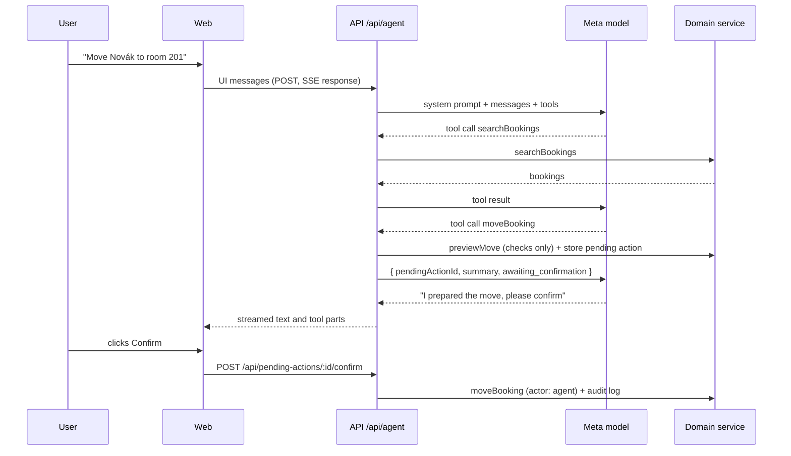
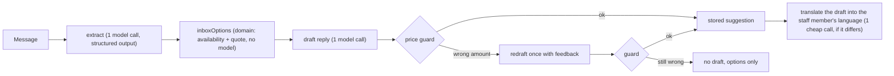

# AI

The agent operates the hotel through the same domain service as the UI. It understands the request, picks tools and writes the reply. Prices, availability and every change come from `packages/domain`.

## Agent loop

Staff talk to the agent in the ⌘K command bar. Answers are structured ([ADR 0011](decisions/0011-structured-agent-answers.md)): the agent writes bookings, rooms and guests as `[[bk_147]]`-style tokens, which the thread renders as chips and booking rows that open the booking and have its right-click menu (`components/agent-thread.tsx`, `components/agent-mention.tsx`, `lib/agent-answer.ts`); what some tools return appears as cards built from the tool output (see [Result cards](#result-cards)); proposed changes appear as confirm cards. The steps of an answer fold into one line ("Checked arrivals and opened the bill") that opens into a timeline with a short result per step and the raw tool input and output one more click away. While the agent works, a thinking orb (`thinking-orbs`) shows the current step and a beam (`border-beam`) runs round the bar. The booking inspector's "Ask Orbit" button opens the bar with the booking as context. The conversation stays in memory until the page reloads or the user starts a new one.

### Result cards

`components/agent-result-cards.tsx` turns finished tool steps into cards under the answer. Amounts come straight from the tool output, never from the model's text.

| Tool                                                       | Card                                                                                                                                                                                                                                              |
| ---------------------------------------------------------- | ------------------------------------------------------------------------------------------------------------------------------------------------------------------------------------------------------------------------------------------------- |
| `getReport`                                                | Occupancy, ADR, RevPAR and room revenue with a bar per night. When the agent also ran the period just before, as it does to compare, the two make one card with the change against it                                                             |
| `getDailyBrief`                                            | Tonight's occupancy, guests, arrivals and departures, then what needs attention as on Today, each row opening where it is handled                                                                                                                 |
| `getArrivals`, `getDepartures`, `searchBookings`           | The bookings as rows that open the booking, five at first. Shown only when the answer doesn't list them as booking rows itself, so they never appear twice                                                                                        |
| `checkAvailability`                                        | Free rooms with their totals; a row opens into the line items, and Hold opens a new booking with the room, stay, party and add-ons filled in                                                                                                      |
| `quote`                                                    | The quote's line items and total                                                                                                                                                                                                                  |
| `getBill`                                                  | The latest bill of each booking: charged, extras, paid and the balance, with a button to open the booking                                                                                                                                         |
| `setRoomStatus`, `createHousekeepingTask`, `setTaskStatus` | What the agent changed, one row per room: old → new status, or the new task. A status change has a button that sets it back, through the same endpoints as the board. A created task can't be undone from the card; it has a link to Housekeeping |

`runAgent` (`packages/ai/src/agent.ts`) calls the AI SDK's `streamText` with the tools, stopping after at most 8 model calls per user message. `POST /api/agent` validates the incoming UI messages, converts them for the model and streams the result back as an AI SDK UI message stream (server-sent events).

## Tools

Defined in `packages/ai/src/tools.ts` with zod input schemas from `packages/shared`. Each is a thin wrapper over the domain service. Domain errors are returned to the model as `{ error: { code, message } }` so it can explain them and try something else.

| Tool                                                       | Does                                                                                                                                                          | Side effect |
| ---------------------------------------------------------- | ------------------------------------------------------------------------------------------------------------------------------------------------------------- | ----------- |
| `listRooms`                                                | Rooms with IDs, kind, type, status                                                                                                                            | none        |
| `searchBookings`                                           | By guest name (accents ignored), room, dates, status                                                                                                          | none        |
| `getBooking`                                               | Booking detail with price breakdown                                                                                                                           | none        |
| `checkAvailability`                                        | Free rooms that fit the party, cheapest first, each with its quote (`roomOptions`); the model sees only each room's total                                     | none        |
| `quote`                                                    | Line-item price for a room or room type                                                                                                                       | none        |
| `getArrivals`, `getDepartures`                             | For a date, default today                                                                                                                                     | none        |
| `getDailyBrief`                                            | The day's brief (see [domain.md](domain.md#daily-brief))                                                                                                      | none        |
| `createHold`                                               | Hold for a new or existing guest                                                                                                                              | proposal    |
| `confirmBooking`, `cancelBooking`                          | Status change                                                                                                                                                 | proposal    |
| `checkIn`, `checkOut`                                      | The check-in summary says how many guests still need an ID; the check-out summary says what is still due                                                      | proposal    |
| `moveBooking`                                              | Same dates, another room                                                                                                                                      | proposal    |
| `changeDates`                                              | New dates, same room, re-priced                                                                                                                               | proposal    |
| `updateBooking`                                            | Party, add-ons, source, notes, and room and dates, in one step; re-priced when the stay changes                                                               | proposal    |
| `getReport`                                                | Occupancy, ADR, RevPAR, revenue, sources, room types, payments and unpaid departures for a period; the daily series goes to the app's chart, not to the model | none        |
| `getBill`                                                  | A booking's bill: stay lines, city tax, extras, payments, balance                                                                                             | none        |
| `addCharge`                                                | Post an extra at the price and tax bracket the staff member gives; the summary shows the balance after                                                        | proposal    |
| `recordPayment`                                            | Payment or refund by cash, card or bank transfer; the summary shows the balance after                                                                         | proposal    |
| `updateCharge`, `removeCharge`                             | Correct or remove an extra on a bill (chargeId from `getBill`); the summary shows the balance after                                                           | proposal    |
| `getGuestBook`                                             | Everyone in a booking's room and what each still needs. Document numbers and addresses are left out; the model only sees whether they are recorded            | none        |
| `addToGuestBook`, `updateGuestBook`, `removeFromGuestBook` | Add a companion, record or correct a person's ID details, take a companion off; the summary shows the values                                                  | proposal    |
| `updateGuestProfile`                                       | A guest's name, email, phone, language or notes                                                                                                               | proposal    |
| `getHousekeeping`                                          | Today's housekeeping board: room status, occupancy, guest, urgency and open tasks                                                                             | none        |
| `setRoomStatus`, `createHousekeepingTask`, `setTaskStatus` | Room status, a new maintenance or cleaning task, a task's progress; status changes return the status before (`from`)                                          | direct      |

"Direct" tools change data straight away, logged in the audit log with actor `agent`: room status and housekeeping tasks are low-risk and reversible ([ADR 0006](decisions/0006-agent-autonomy-and-cost-budget.md)), the same rule as for voice notes. Everything else that changes data is a proposal.

## Approval pattern

See [ADR 0004](decisions/0004-human-approval-for-mutations.md). A proposal tool:

1. Runs the domain operation's `preview*` function, which applies every rule against current data without saving. An invalid change fails here and the model hears why.
2. Stores a `PendingAction` with the exact arguments, a one-line summary for the model, e.g. `Move Tomáš Novák (2026-10-27 to 2026-10-29 (2 nights)) from room 104 to room 201`, and `details` for the confirm card: one row per thing that changes with its value before and after (Room 104 → 201), the stay total or bill balance before and after, and a note such as IDs still missing.
3. Returns `{ pendingActionId, summary, status: 'awaiting_confirmation' }`.

The UI shows a confirm card (`components/pending-action-card.tsx`): what kind of change it is, the booking it concerns as a row, the changed values with the old one struck through, the money it moves, and Confirm and Reject. Values are as they were when the change was proposed; each card's balance assumes only its own change, so after confirming two bill changes the balance is the result of both. When one answer proposes several changes, "Confirm all" confirms those still waiting, one after another. `POST /api/pending-actions/:id/confirm` runs the stored arguments (never ones sent by the browser) through the domain service with actor `agent`, writing the audit log. If the data changed in the meantime and the action is no longer valid, it is marked `failed` with the reason. Each action can be resolved once: confirming claims it with a conditional update first, so two clicks at the same time run the change only once.

## Inbox pipeline

A conversation is prepared only when staff click "Draft reply" ([ADR 0012](decisions/0012-inbox-conversations-and-ai-on-request.md)); opening one never calls a model (`packages/ai/src/inbox.ts`). The model reads the whole conversation, oldest message first, and answers the guest's latest message. The result is stored until the guest writes again, so asking again costs nothing.

1. **Extract**: `generateText` with `Output.object(inquiryExtractionSchema)` (Meta `response_format: json_schema`, `strictJsonSchema: false` because strict mode only adds a server check that may reject keywords zod emits). Classifies the message (`booking_request`, `question`, `other`), its language, stay, party and wishes.
2. **Options** (no model): for a complete booking request, `hotel.inboxOptions` finds free rooms (an apartment if asked for, or if a dog comes, per `hotelPolicy.dogsAllowedIn`) and quotes up to three, one per room type, with wished add-ons. If staff already hold a room for the message, that room leads the options at its quoted price (it is no longer free), and the draft presents it alone: held for the guest until the hold ends (`holdExpiry`, in the hotel's time zone and clock), asking them to confirm.
3. **Draft**: the model (Muse Spark Open when Baseten is configured, see [below](#muse-spark-open-on-baseten)) writes a reply in the guest's language, given the exact totals as text in the hotel's currency (e.g. `$1,156` or `12 500 CZK`). When taxes are added on the bill it says so, without working them out. It greets guests by the name they signed with, never a guessed title.
4. **Price guard** (`price-guard.ts`): every money amount in the draft must be one of the quoted totals, line amounts or unit prices, or an amount the hotel profile states, and every option's total must appear. Czech, German, Polish and English number formats are recognised. A failing draft is regenerated once; if it fails again, no draft is shown, so a wrong price never reaches a guest.

5. **In the staff's language** (`translate.ts`): when the staff member who asked reads another language than the guest writes, the draft is translated into theirs (`draftTranslation`). The reply box opens on that version with a tab for the guest's; staff edit either and translate it into the other, only the guest's text is sent, and sending waits until edits in the staff's language are translated.

The pipeline checks the monthly budget before calling the model and records `inbox_extract`, `inbox_draft` and `translate` usage separately. Errors are stored on the conversation (`processingError`) and the next request retries.

### Translation

`createTranslator` (`packages/ai/src/translate.ts`) translates guest messages into the reader's language and reply texts both ways, only when staff ask. It runs on Muse Spark Open when Baseten is configured, otherwise on `META_MODEL_TRANSLATE` (the agent model when unset; Meta has no cheaper Standard-tier text model yet), at `minimal` reasoning. The prompt keeps names, dates, room numbers and every amount with its currency as written; `sameAmounts` checks that the translation states the same amounts as the source, and one that doesn't is redone once and otherwise refused (`translation_failed`). A guest message's translation is stored with the message. A translation costs about $0.002.

## Housekeeping notes

A housekeeper records a voice note ("room 104 done, the bedside lamp is broken") or types one. `createHousekeepingNotePipeline` (`packages/ai/src/housekeeping.ts`):

1. **Transcribe** with `muse-voice-transcribe-1.0` (`transcribeWav`, `packages/ai/src/transcribe.ts`). Meta's `POST /asr/transcribe` is not OpenAI-compatible: a multipart body with a JSON `request` part (`model`, `audioEncoding: "WAV"`, `mode: "PUSH_TO_TALK"`, `keywords`) and an `audio` part holding mono 16-bit PCM WAV at 16 kHz. The room names are sent as `keywords` to bias recognition. The browser records and converts to that format.
2. **Read** the transcript into `{ updates: [{ room, status, issue }], unclear }` with one structured-output call, given the list of room names. Spoken numbers count ("sto dva" is 102); issues come back as short English sentences.
3. **Apply** in the domain as the agent, without a confirm card: room status and maintenance tasks are low-risk and reversible ([ADR 0006](decisions/0006-agent-autonomy-and-cost-budget.md)). The domain matches room names and skips unknown rooms or forbidden changes with a reason. Every change is in the audit log.

Usage is recorded under the `voice` feature: audio seconds for the transcription, tokens for the reading.

## ID scans

Staff scan a guest's ID card or passport with a phone at check-in, or later when it was missing ([domain.md](domain.md#id-scans)). The desk shows a QR code for a 15-minute link; the phone photographs the document and the browser re-encodes it as a JPEG of at most 1600 px. `readIdDocument` (`packages/ai/src/id-scan.ts`) sends it to `META_MODEL_VISION` as a file part in one structured-output call (`idDocumentReadingSchema`): whether an ID is readable, its type, the name as printed, nationality as ISO alpha-2, dates as `YYYY-MM-DD`, the document number and an address if printed. The prompt (`prompts/id-scan.ts`) says to copy, never guess, and to check dates against the machine-readable zone.

The domain checks every value before staff see it and turns problems (an expired document, a different name than the booking's) into warnings. Staff review and correct the values on the desk and save them; the model never writes to the guest book. The photo exists only in memory for the one call. Usage is recorded under `id_scan`, at `minimal` reasoning effort.

## Prompts

Hotel facts come from the **hotel profile** staff edit in Settings ([domain.md](domain.md#hotel-profile)), read for every agent turn and every draft, so a change applies to the next message. `hotelFacts` (`packages/ai/src/prompts/hotel.ts`) turns it into one block: name, location, description, contact, check-in and check-out times (written "3 PM" for a US hotel), how prices are stated (`pricesSentence`: currency, per room or person, and whether taxes are included or added, with their names and rates), then the policies, amenities and guest information, then the rules the domain enforces, written out from `hotelPolicy` (hold length, where dogs may stay) so the model never contradicts them.

`packages/ai/src/prompts/system.ts` builds the agent's system prompt from that block, today's date and the hotel timezone. The prompt tells the model to use tools for every fact, never to compute prices or availability, that changes are proposals, and to answer questions about the hotel only from the profile, saying so when Settings does not cover something. `draftSystemPrompt` (`prompts/inbox.ts`) gives reply drafts the same block. The block has no dates, so it is identical between calls and Meta's prefix cache applies.

## Evals

`packages/ai/src/evals/inquiries.ts` holds fourteen synthetic messages in Czech, German, English and Polish, dated relative to today: ten booking requests and four OTA (Booking.com) messages, three of which are questions about an existing stay. Each has its expected extraction. The demo seed uses the same messages.

`packages/ai/src/evals/housekeeping-notes.ts` holds ten synthetic housekeeping notes in Czech, English, German and Polish, including spelled-out numbers, an unknown room and a note too vague to act on. They are scored by `scoreHousekeepingNote`: the same rooms, status per room, whether an issue was reported, and whether something was flagged as unclear.

`packages/ai/src/evals/id-documents.ts` holds three synthetic specimen documents drawn for the eval, each marked SPECIMEN and photographed slightly askew (`id-documents/*.jpg`, rendered from the SVGs beside them): a Czech-style ID card, a German-style passport with a machine-readable zone, and a café receipt that must be refused as unreadable. `scoreIdReading` needs every expected field exact (names case-insensitively). The suite runs when `META_MODEL_VISION` is set.

`packages/ai/src/evals/agent.ts` holds nine staff requests for the agent (one in Czech) against a four-room in-memory hotel dated relative to today: mark a room clean, log a repair, who still needs an ID, add a companion from spoken ID details, record the main guest's ID, remove and correct a bill extra, change a guest's email, and a guest-book question. Each runs the real agent with the real tools and is checked by its effect: the room status or task it created, or exactly one proposal of the right kind with the right arguments, or no change at all for a question (plus the tool it should read, and that the answer names the right guests with their diacritics and without booking IDs).

The reply draft suite (`evals/drafts.ts`) drafts a reply to every inbox message except `other`, from its expected extraction and real quoted options on an empty four-room lodge at the US demo rates, and passes when the draft is not empty and the price guard accepts it: every total stated, no amount that wasn't quoted. Each line names the model that answered, so a fallback to Meta shows.

`packages/ai/src/evals/translations.ts` holds four texts to translate: a Czech reply draft with a price into German and English, and a German and a Polish guest message into Czech. Each must keep its amounts, names and numbers, read as the target language, and come without a preamble.

`pnpm eval` runs all suites: the real extraction on each inbox message and scores it with `scoreExtraction`: exact match on kind, language, dates, adults, child ages (any order) and wishes; guest name and question wording are not scored. It prints PASS/FAIL per message, the pass rate, the cost, and output tokens and seconds per message. It needs `META_API_KEY` and `META_MODEL_AGENT`. `EVAL_REASONING=<level>` overrides the reasoning effort to compare levels. `EVAL_SUITES` runs some suites only, e.g. `EVAL_SUITES=drafts,translations` (`inbox`, `notes`, `ids`, `agent`, `drafts`, `translations`). With `BASETEN_API_KEY` and `BASETEN_MODEL` set, drafts and translations are measured on Muse Spark Open, as in the app.

Latest results with `muse-spark-1.3` (2026-10-27):

| Reasoning effort   | Pass rate    | Cost per message | Output tokens | Time  |
| ------------------ | ------------ | ---------------- | ------------- | ----- |
| model default      | 14/14 (100%) | $0.0061          | 1,207         | 4.4 s |
| `low`              | 14/14 (100%) | $0.0036          | 564           | 2.3 s |
| `minimal` (in use) | 14/14 (100%) | $0.0021–0.0025   | ~300          | 1.4 s |

ID scans with `muse-spark-1.3` at `minimal` (2026-10-28): 3/3 (100%), about $0.0026 per scan, 1.7 s.

Reply drafts and translations at `minimal` (2026-10-29):

| Model                                               | Drafts       | Per draft      | Translations |
| --------------------------------------------------- | ------------ | -------------- | ------------ |
| `muse-spark-1.3` (Meta Model API)                   | 14/14 (100%) | $0.0025, 2.6 s | 4/4 (100%)   |
| `meta-models/muse-spark-open-1026` (Baseten, `low`) | 14/14 (100%) | $0.0040, 3.2 s | 4/4 (100%)   |

## Meta models

The Meta Model API is OpenAI-compatible, so `packages/ai/src/provider.ts` wraps the AI SDK's `@ai-sdk/openai-compatible` provider pointed at `META_API_BASE_URL`. `apps/api` builds it from env vars and turns AI off when `META_API_KEY` or `META_MODEL_AGENT` is missing.

| Env var             | Model (from the Meta Model API docs) | Used for                                                                                           |
| ------------------- | ------------------------------------ | -------------------------------------------------------------------------------------------------- |
| `META_MODEL_AGENT`  | `muse-spark-1.3`                     | Agent loop and tool calling (Chat Completions)                                                     |
| `META_MODEL_VISION` | `muse-spark-1.3` (accepts images)    | Reading ID documents for the guest book                                                            |
| `META_MODEL_VOICE`  | `muse-voice-transcribe-1.0`          | Housekeeping voice notes, through Meta's own `/v1/asr/transcribe` endpoint (not OpenAI-compatible) |

Muse Spark is a reasoning model: it always reasons before answering (`reasoning_effort: "none"` is rejected), and reasoning tokens are billed as output. `packages/ai/src/reasoning.ts` sets the effort per feature through the AI SDK's `reasoning` option: `minimal` for inbox extraction, drafts, housekeeping notes and ID scans, `low` for the agent, which plans multi-step tool use. Each is the lowest level that keeps quality, measured with `pnpm eval` and live runs.

### Muse Spark Open on Baseten

Muse Spark Open is Meta's open-weight release of Muse Spark; Orbit uses the dated `meta-models/muse-spark-open-1026` (`BASETEN_MODEL`). With `BASETEN_API_KEY` and `BASETEN_MODEL` set, reply drafts and translations run on it through Baseten's OpenAI-compatible Model API (`BASETEN_BASE_URL`, default `https://inference.baseten.co/v1`); the agent, inbox extraction, housekeeping notes and ID scans stay on the Meta Model API ([ADR 0015](decisions/0015-muse-spark-open-on-baseten.md)).

- Baseten serves it without structured output or JSON mode, so it takes only the two plain-text features.
- It always reasons and defaults to `xhigh`; the features send `minimal`, which Baseten runs as `low`, its lowest level.
- `withFallback` (`packages/ai/src/fallback.ts`) wraps it: a call that fails (credits used up, rate limit, outage) is sent again to Meta's model, the agent model for drafts and `META_MODEL_TRANSLATE` for translations. Usage is recorded under the model that answered.
- Prices are the same as Meta's Standard tier, and its spend counts towards the same `AI_MONTHLY_BUDGET_USD`.

Constraints from Meta's tool-calling docs that the agent respects: `tool_choice` only accepts `"auto"` (the SDK default), and tool arguments are not guaranteed to match the schema, so the SDK validates them with the zod schemas.

## Cost

Rules in [ADR 0006](decisions/0006-agent-autonomy-and-cost-budget.md). Prices (Standard tier, `packages/ai/src/cost.ts`): $1.25 per 1M input tokens, $0.15 per 1M cached input tokens, $4.25 per 1M output tokens, $0.18 per hour of transcribed audio.

Every model call is recorded in the `ai_usage` table (feature, model, tokens, cost in micro-dollars). This table is real spend, so `db:seed` and demo resets leave it alone. `GET /api/ai-usage` reports this month's spend by feature against `AI_MONTHLY_BUDGET_USD`. If a client disconnects mid-turn, the completed steps are still recorded; the step in flight is not reported by the provider.

What keeps cost down:

- Meta caches prompt prefixes automatically, so the system prompt and tool definitions come first and today's date comes last.
- Only the last 20 chat messages are sent; at most 8 model calls per turn.
- Background work (inbox extraction and drafts) runs once per message and is stored.

Measured with `muse-spark-1.3` (2026-10-28, 31 tools): each agent step sends about 10,000 input tokens (system prompt and tool definitions, cached after the first call), so a question answered from one lookup costs about $0.005 and a change that needs lookups first about $0.02–0.03; the average turn stays near $0.019. An inbox message costs about $0.004 (extraction $0.002 plus draft at `minimal` effort).

Estimate for a 30-room property per month, at 40 agent questions and 30 guest messages a day: agent ≈ $23, inbox ≈ $4, ID scans, voice notes and daily briefs ≈ $2. Total ≈ $30, well under the $100 cap.

## Rate limits

The public demo is protected in `apps/api/src/limits.ts` (in memory, reset on restart):

- `AI_RATE_LIMIT_PER_HOUR` agent requests per client IP per rolling hour (IP from `x-forwarded-for`).
- `AI_DAILY_TOKEN_BUDGET` tokens per UTC day across all visitors, counted from model usage after each turn. The default of 2,000,000 is about 100 agent turns, or roughly $2 a day.
- `AI_MONTHLY_BUDGET_USD` real spend per UTC month, from the `ai_usage` table. Persisted, so it survives restarts.

Baseten allows 15 requests a minute on an unverified account and 120 once verified; beyond that a draft or translation falls back to Meta's API.

When a limit is hit, `POST /api/agent` returns 429 `demo_limit` with a message the command bar can show as is.
