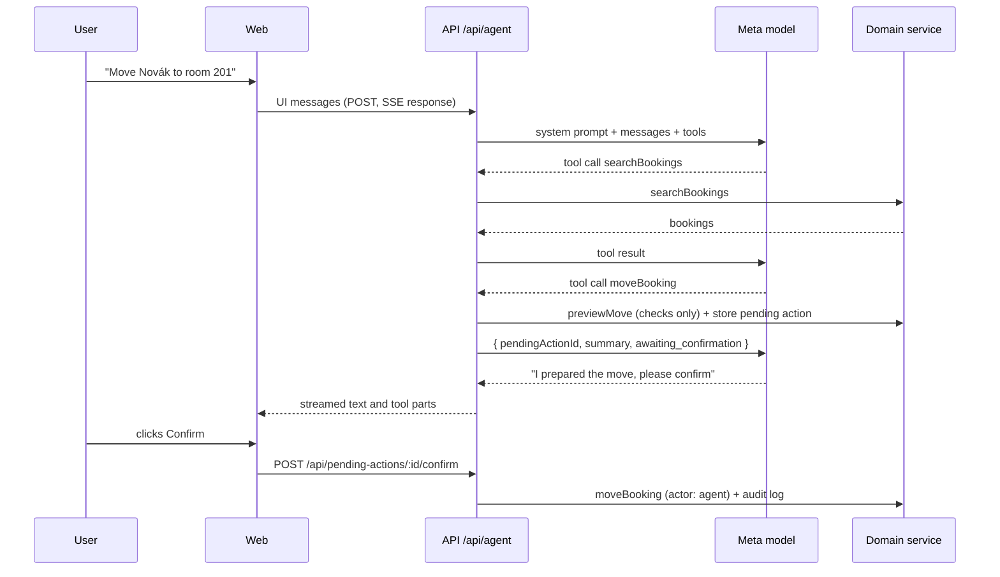
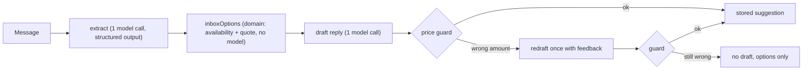

# AI

The agent operates the hotel through the same domain service as the UI. It understands the request, picks tools and writes the reply. Prices, availability and every change come from `packages/domain`.

## Agent loop

`runAgent` (`packages/ai/src/agent.ts`) calls the AI SDK's `streamText` with the tools, stopping after at most 8 model calls per user message. `POST /api/agent` validates the incoming UI messages, converts them for the model and streams the result back as an AI SDK UI message stream (server-sent events).

## Tools

Defined in `packages/ai/src/tools.ts` with zod input schemas from `packages/shared`. Each is a thin wrapper over the domain service. Domain errors are returned to the model as `{ error: { code, message } }` so it can explain them and try something else.

| Tool                              | Does                                                 | Side effect |
| --------------------------------- | ---------------------------------------------------- | ----------- |
| `listRooms`                       | Rooms with IDs, kind, type, status                   | none        |
| `searchBookings`                  | By guest name (accents ignored), room, dates, status | none        |
| `getBooking`                      | Booking detail with price breakdown                  | none        |
| `checkAvailability`               | Free rooms that fit the party, cheapest first        | none        |
| `quote`                           | Line-item price for a room or room type              | none        |
| `getArrivals`, `getDepartures`    | For a date, default today                            | none        |
| `createHold`                      | Hold for a new or existing guest                     | proposal    |
| `confirmBooking`, `cancelBooking` | Status change                                        | proposal    |
| `moveBooking`                     | Same dates, another room                             | proposal    |
| `changeDates`                     | New dates, same room, re-priced                      | proposal    |

## Approval pattern

See [ADR 0004](decisions/0004-human-approval-for-mutations.md). A proposal tool:

1. Runs the domain operation's `preview*` function, which applies every rule against current data without saving. An invalid change fails here and the model hears why.
2. Stores a `PendingAction` with the exact arguments and a one-line summary, e.g. `Move Tomáš Novák (2026-10-27 to 2026-10-29 (2 nights)) from room 104 to room 201`.
3. Returns `{ pendingActionId, summary, status: 'awaiting_confirmation' }`.

The UI shows a confirm card. `POST /api/pending-actions/:id/confirm` runs the stored arguments (never ones sent by the browser) through the domain service with actor `agent`, writing the audit log. If the data changed in the meantime and the action is no longer valid, it is marked `failed` with the reason. Each action can be resolved once.

## Inbox pipeline

Every guest message, direct or relayed by an OTA, is prepared in the background when staff open it (`packages/ai/src/inbox.ts`). It runs once per message and the result is stored, so reopening costs nothing.

1. **Extract**: `generateText` with `Output.object(inquiryExtractionSchema)` (Meta `response_format: json_schema`, `strictJsonSchema: false` because strict mode only adds a server check that may reject keywords zod emits). Classifies the message (`booking_request`, `question`, `other`), its language, stay, party and wishes.
2. **Options** (no model): for a complete booking request, `hotel.inboxOptions` finds free rooms (an apartment if asked for, or if a dog comes, per `hotelPolicy.dogsAllowedIn`) and quotes up to three, one per room type, with wished add-ons.
3. **Draft**: the model writes a reply in the guest's language, given the exact totals as text (e.g. `12 500 CZK`).
4. **Price guard** (`price-guard.ts`): every money amount in the draft must be one of the quoted totals, line amounts or unit prices, and every option's total must appear. Czech, German, Polish and English number formats are recognised. A failing draft is regenerated once; if it fails again, no draft is shown, so a wrong price never reaches a guest.

The pipeline checks the monthly budget before calling the model and records `inbox_extract` and `inbox_draft` usage separately. Errors are stored on the message (`processingError`) and the next open retries.

## Prompts

`packages/ai/src/prompts/system.ts` builds the system prompt from a `HotelProfile` (`packages/ai/src/hotel.ts`: name, location, check-in and check-out times, policies), today's date and the hotel timezone. The prompt tells the model to use tools for every fact, never to compute prices or availability, and that changes are proposals.

## Evals

`packages/ai/src/evals/inquiries.ts` holds fourteen synthetic messages in Czech, German, English and Polish, dated relative to today: ten booking requests and four OTA (Booking.com) messages, three of which are questions about an existing stay. Each has its expected extraction. The demo seed uses the same messages.

`pnpm eval` runs the real extraction on each and scores it with `scoreExtraction`: exact match on kind, language, dates, adults, child ages (any order) and wishes; guest name and question wording are not scored. It prints PASS/FAIL per message, the pass rate and what the run cost. It needs `META_API_KEY` and `META_MODEL_AGENT`.

## Meta models

The Meta Model API is OpenAI-compatible, so `packages/ai/src/provider.ts` wraps the AI SDK's `@ai-sdk/openai-compatible` provider pointed at `META_API_BASE_URL`. `apps/api` builds it from env vars and turns AI off when `META_API_KEY` or `META_MODEL_AGENT` is missing.

| Env var             | Model (from the Meta Model API docs) | Used for                                                                                    |
| ------------------- | ------------------------------------ | ------------------------------------------------------------------------------------------- |
| `META_MODEL_AGENT`  | `muse-spark-1.3`                     | Agent loop and tool calling (Chat Completions)                                              |
| `META_MODEL_VISION` | `muse-spark-1.3` (accepts images)    | Not wired yet                                                                               |
| `META_MODEL_VOICE`  | `muse-voice-transcribe-1.0`          | Not wired yet; uses Meta's own `/v1/asr/transcribe` endpoint, not the OpenAI-compatible one |

Constraints from Meta's tool-calling docs that the agent respects: `tool_choice` only accepts `"auto"` (the SDK default), and tool arguments are not guaranteed to match the schema, so the SDK validates them with the zod schemas.

## Cost

Rules in [ADR 0006](decisions/0006-agent-autonomy-and-cost-budget.md). Prices (Standard tier, `packages/ai/src/cost.ts`): $1.25 per 1M input tokens, $0.15 per 1M cached input tokens, $4.25 per 1M output tokens, $0.18 per hour of transcribed audio.

Every model call is recorded in the `ai_usage` table (feature, model, tokens, cost in micro-dollars). This table is real spend, so `db:seed` and demo resets leave it alone. `GET /api/ai-usage` reports this month's spend by feature against `AI_MONTHLY_BUDGET_USD`. If a client disconnects mid-turn, the completed steps are still recorded; the step in flight is not reported by the provider.

What keeps cost down:

- Meta caches prompt prefixes automatically, so the system prompt and tool definitions come first and today's date comes last.
- Only the last 20 chat messages are sent; at most 8 model calls per turn.
- Background work (inbox extraction and drafts) runs once per message and is stored.

Estimate for a 30-room property per month: inbox ~1,000 messages at two small calls each ≈ $8, chat ~900 turns ≈ $25–35, ID scans, voice notes and daily briefs ≈ $2. Total ≈ $35–45.

## Rate limits

The public demo is protected in `apps/api/src/limits.ts` (in memory, reset on restart):

- `AI_RATE_LIMIT_PER_HOUR` agent requests per client IP per rolling hour (IP from `x-forwarded-for`).
- `AI_DAILY_TOKEN_BUDGET` tokens per UTC day across all visitors, counted from model usage after each turn.
- `AI_MONTHLY_BUDGET_USD` real spend per UTC month, from the `ai_usage` table. Persisted, so it survives restarts.

When a limit is hit, `POST /api/agent` returns 429 `demo_limit` with a message the agent panel can show as is.
