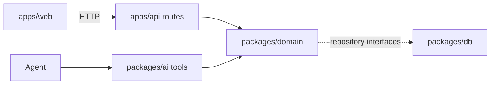
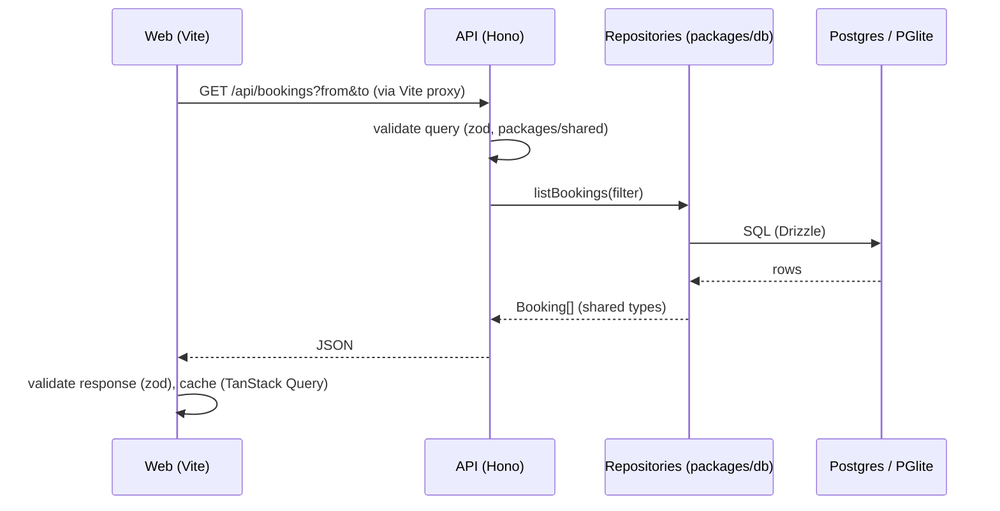

# Architecture

## Layers

Orbit PMS is a pnpm monorepo. Each layer has one job:

| Package           | Role                                                                         |
| ----------------- | ---------------------------------------------------------------------------- |
| `apps/web`        | React UI. No business logic.                                                 |
| `apps/api`        | Hono server. Thin routes that validate input and call the domain.            |
| `packages/domain` | Pure TypeScript business logic. No I/O except through repository interfaces. |
| `packages/db`     | Drizzle schema, migrations, seed, repository implementations.                |
| `packages/ai`     | Meta model provider, agent tools, prompts, evals.                            |
| `packages/shared` | zod schemas and types used across packages.                                  |

## The architecture rule

UI actions and agent tools call the same domain functions.

## Data flow

Repositories implement the interfaces declared in `packages/domain/src/repositories.ts`, so domain code never imports a database driver.

## Web UI

The app shell is a gray canvas with a sidebar (the Orbit mark with the hotel's name, navigation split into front desk and office, the ⌘K button, the signed-in staff member with a menu to switch user, appearance) and one white main panel beside it. Each page renders its own `PageHeader` (the title bar at the top of the panel) and body. Two overlays are shared by every page:

- **Command bar** (`components/command-palette.tsx`, ⌘K): search guests and today's arrivals and departures, jump to a page, switch appearance, and talk to the agent. The agent lives here rather than in a chat side panel, see [ADR 0007](decisions/0007-command-bar-for-the-agent.md). `useCommandPalette().openPalette({ mode, text })` opens it from anywhere with context, for example from a booking.
- **Today** (`pages/dashboard.tsx`): a greeting for the time of day, then tonight's occupancy and counts next to the house map (`components/house-map.tsx`, `lib/house-map.ts`): every room drawn as a tile, one row per floor from the top down, colored by tonight from the housekeeping board (`GET /api/housekeeping`): staying, arriving, turnover, leaving, free or out of order. Below it the daily brief (`GET /api/brief`) as a "needs attention" list (rooms to prepare, missing IDs, holds, unanswered messages, repairs) and short gaps to sell, each linking to where it is handled; then today's arrivals, departures and in-house guests.
- **Inbox** (`pages/inbox.tsx`, `/inbox/:id`): a mail client for every guest channel: folders (inbox, unread, needs a reply, archived), channel filters and search, conversations with their history (`components/inbox-conversation.tsx`), new emails and pasted guest messages (`components/inbox-dialogs.tsx`). Opening a conversation marks it read and calls no model; "Prepare a reply" asks for the agent's reading, priced rooms with Hold buttons and a draft, which shows side by side with the staff member's language. Guest messages translate on request.
- **Housekeeping** (`pages/housekeeping.tsx`): rooms in status columns, dragged to change status, with today's occupancy and open tasks. A voice note is recorded with `MediaRecorder`, converted in the browser to the 16 kHz mono WAV Meta's speech-to-text takes (`lib/wav.ts`), and uploaded; a typed note works without a microphone.
- **Reports** (`pages/reports.tsx`, `/reports?period=`): occupancy, ADR, RevPAR and room revenue for a preset period (last 7 or 30 days, this or last month, next 30 days on the books), each compared with the same number of nights before; smaller figures for add-ons, extras, city tax and stays; nightly occupancy bars with a tooltip and a screen-reader table; room types and sources; payments by method; and departed guests who still owe, which open their booking.
- **Activity** (`pages/activity.tsx`, `/activity?actor=`): the latest 100 changes hotel-wide, grouped by day and filterable to staff or Orbit, each with what it was about (linking to the booking, guest, message, room or setting), who made it when recorded, and a one-line detail such as an amount or a status change. Action labels (`lib/activity.ts`) are shared with the inspector's activity list.
- **Settings** (`pages/settings.tsx`, `/settings/:section`): the hotel profile in four tabs (property details, policies, amenities, guest info) that share one draft and save together; the rates (seasons, child and long-stay discounts, add-on prices), a separate draft with its own save; room types with base prices and rooms, edited in dialogs; and the team. Room and team changes save right away. Staff who are not managers see everything read-only.
- **Welcome page** (`pages/welcome.tsx`, `/welcome`): the public landing page. "Enter demo" signs the visitor in as the first active manager with one click, no credentials, and returns them to the page they asked for (`?next=`). On wide screens the scene fills the page and the sign-in panel floats over it, inset from the top, bottom and right; on phones the scene sits above the panel. The scene (`components/welcome-scene.tsx`) keeps its glitches to the part not covered by the panel and composes the picture there. It renders in two WebGL passes (`lib/dusk-shader.ts`). The scene pass paints a blurred dusk over a two-layer mountain ridge, with a light leak, red planets, a warm town glow and head and tail lights streaking past, at half resolution into a texture with headroom above white. The post pass runs at full resolution: halation around the lights, colour fringing, a vignette and fine film grain at 24 fps. It also draws up to 12 glitch windows at once (`lib/glitch-windows.ts`), opaque and hard-edged, each wiping on from its left edge and off towards its right: two overlapping streams of stepped bar stacks that drift slowly sideways, each bar a pixel-sort smear (soft stripes dragging the brightest colours down their column), ASCII over a smear, or ASCII; tall ASCII columns on the right; and the pointer, an ASCII lens that wipes on while it hovers. The ASCII is made from the image: each cell's glyph follows the brightness under it. On load the whole picture starts as ASCII and resolves from the top down. A text overlay types what is happening at the demo hotel onto dark smears, in two streams so a message shows most of the time and often two at once (`lib/scene-messages.ts`): guests arriving and checking out, occupancy, rooms to get ready, repairs, holds, waiting messages and empty nights. Without WebGL the panel falls back to a plain gradient. With reduced motion it renders one still frame.
- **Signed-in staff member** (`lib/session.ts`, `hooks/use-session.ts`): the ID is kept in the browser and sent as `x-staff-id` with every request ([ADR 0009](decisions/0009-staff-roles-and-demo-sign-in.md)). Without a stored, active staff member the app redirects to the welcome page. The sidebar's user menu switches who is signed in, without a password, and signs out.
- **Booking editor** (`components/booking-editor.tsx`): one dialog for new and existing bookings: dates, party, add-ons, a free room picked from `POST /api/availability` with its price, guest (existing or new), source, notes, and for new bookings hold or confirmed. Edits show the new total from `POST /api/bookings/:id/preview` before saving. `useBookingEditor().openNew(prefill)` / `openEdit(id)` open it from anywhere: the Today and tape chart headers, an empty tape chart night (click or right-click), a guest's page, an inbox message (prefilled from the sender and the agent's reading), and ⌘K.
- **Context menus** (`components/booking-menu.tsx`): right-click a booking on the tape chart, in a list or on a guest's page for open, edit, the allowed status actions, guest profile, Ask Orbit and cancel (with a confirmation). The inspector's "More" button shows the same menu. Housekeeping room cards have their own menu to set the status without dragging or add a task.
- **Error pages** (`components/route-error.tsx`): a page that crashes shows an error in the workspace while the sidebar keeps working, and navigating away clears it; if the app shell itself crashes, a full-page error replaces it. Both offer Reload and Go to Today, and show the error details in development.
- **Booking inspector** (`components/booking-drawer.tsx`): opened by `?booking=<id>`, so any page, link or agent result can open a booking (`&intent=check-in` opens it straight into check-in). A header with the dates, party, balance due and missing IDs as chips, then four tabs:
  - **Overview**: the stay (dates, party and room change through the booking editor; source and notes edit in place) and the main guest's contact details, edited in place (`components/inline-field.tsx`: click a value, Enter or leaving saves, Escape cancels).
  - **Guests** (`components/booking-guests.tsx`): one card per person in the room with their guest-book fields edited in place and what is still missing, plus open slots for people the party counts that nobody added. Each person can be scanned (`components/id-scan-dialog.tsx`): a QR code for the phone page (`pages/scan.tsx`, `/scan/<id>`, outside the app shell and without sign-in), or a photo uploaded at the desk; the read values are reviewed and corrected before saving.
  - **Bill** (`components/booking-bill.tsx`): charged, paid and balance; the stay, city tax and extras, each with its tax rate; extras added and corrected in place with a tax bracket; taxes added on top as their own lines when prices are before tax; payments; and the VAT recap per bracket.
  - **Activity**: the booking's audit log.

  Check-in (`components/check-in-dialog.tsx`) walks through the guest book (scan or type each person, or continue without all IDs), the bill (take a payment now or at check-out) and the room (its housekeeping status, what is still missing). Checking out with money still due asks first and offers to take the payment. From a context menu, both actions open the inspector.

Money, dates and times are written for the hotel's region (`lib/format.ts`, set by `components/region-provider.tsx` from the rates, profile and `/health`): "$1,250", "Wed, Oct 28" and "3:30 PM" for a US hotel in its time zone, "12,500 CZK", "Wed 28 Oct" and "15:30" elsewhere ([ADR 0013](decisions/0013-configurable-region-us-demo.md)).

Styling comes from design tokens in `apps/web/src/index.css`: surfaces, text, borders, status colors for bookings and rooms, shadows and a 13 px type scale, each defined for light and dark mode. Depth comes from three layers instead of borders: the canvas (`bg-sidebar`), the white main panel (`rounded-card`, 14 px) and pale wells inside it (`bg-surface-sunken`). `Panel` (`components/panel.tsx`) is the standard card: a well with a caption row (optional count and actions) holding its content in a white box (`rounded-stage`, 10 px); `bare` lays the content straight on the well. Controls use `rounded-control` (8 px). The main panel, raised buttons and floating panels carry a lit hairline (`.stroke-lit`), a 1 px gradient ring drawn on `::after` and brightest at the top. Primary actions are ink buttons (`bg-ink`, `shadow-button`), secondary ones raised white buttons (`fill-action`, `shadow-action`); the accent marks only selection, focus and progress. Avatars are aurora orbs (`.bg-orb`, hue turned per name by `orbShift`); the logo is a typographic wordmark, "orbit" in lowercase Geist set tight (`Wordmark`, just the "o" in the collapsed sidebar), and while the agent works a beam (`border-beam`) runs round the ⌘K bar and a thinking orb (`thinking-orbs`) stands in for a spinner. Room numbers, prices and shortcuts use Geist Mono. Tape chart bars use `--bar-*` tints, the status color mixed into the frame in oklab (an oklch mix with white would swing the hue). The accent is one hue (`--accent-hue`, `--accent-chroma`), so changing it re-colors every accent. Each color token has a day and a night value, blended by `--night` (light = 0, dark = 1). `--night` is a registered CSS property, so switching themes fades instead of snapping. The **daylight** theme (`lib/daylight.ts`) turns the app light at 06:30 and dark at 19:30 local time, and adds a soft glow behind and through the content panel whose color follows real daylight: indigo blue hour, pink dawn, golden sunrise, near-white midday with a pale sky blue, golden hour, orange-to-violet sunset, then faint moonlight. The workspace layer blends like light on a surface (multiply in light mode, screen in dark), so text keeps its color. The appearance menu has a slider to preview any time of day; the pinned time is stored in the browser until "Back to now". Components use the tokens through Tailwind utilities (`bg-status-hold`, `text-primary-text`, `shadow-raised`) and never raw colors. Reusable pieces (`PageHeader`, `Section`, `Panel`, `Wordmark`, `PropertyList`, `BookingList`, `StatusDot`, `GuestAvatar`, `EmptyState`, `ErrorNotice`) live in `apps/web/src/components/`; shadcn primitives are in `components/ui/`.
