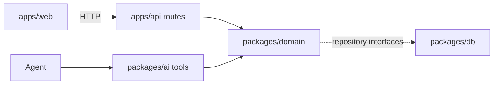
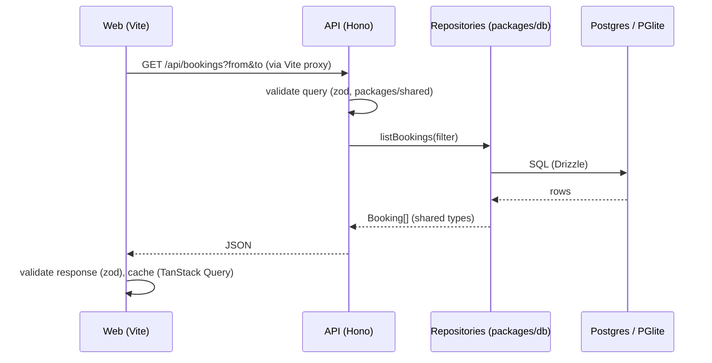

# Architecture

## Layers

Orbit PMS is a pnpm monorepo. Each layer has one job:

| Package           | Role                                                                         |
| ----------------- | ---------------------------------------------------------------------------- |
| `apps/web`        | React UI. No business logic.                                                 |
| `apps/api`        | Hono server. Thin routes that validate input and call the domain.            |
| `packages/domain` | Pure TypeScript business logic. No I/O except through repository interfaces. |
| `packages/db`     | Drizzle schema, migrations, seed, repository implementations.                |
| `packages/ai`     | Meta model provider, agent tools, prompts, evals.                            |
| `packages/shared` | zod schemas and types used across packages.                                  |

## The architecture rule

UI actions and agent tools call the same domain functions.

## Data flow

Repositories implement the interfaces declared in `packages/domain/src/repositories.ts`, so domain code never imports a database driver.

## Web UI

The app shell is a sidebar (navigation, the ⌘K button, the signed-in staff member with a menu to switch user, appearance) and one content panel per page. Each page renders its own `PageHeader` and body. Two overlays are shared by every page:

- **Command bar** (`components/command-palette.tsx`, ⌘K): search guests and today's arrivals and departures, jump to a page, switch appearance, and talk to the agent. The agent lives here rather than in a chat side panel, see [ADR 0007](decisions/0007-command-bar-for-the-agent.md). `useCommandPalette().openPalette({ mode, text })` opens it from anywhere with context, for example from a booking.
- **Today** (`pages/dashboard.tsx`): the daily brief (`GET /api/brief`) as tonight's numbers, a "needs attention" list (rooms to prepare, holds, unanswered messages, repairs) and short gaps to sell, each linking to where it is handled; then today's arrivals, departures and in-house guests.
- **Housekeeping** (`pages/housekeeping.tsx`): rooms in status columns, dragged to change status, with today's occupancy and open tasks. A voice note is recorded with `MediaRecorder`, converted in the browser to the 16 kHz mono WAV Meta's speech-to-text takes (`lib/wav.ts`), and uploaded; a typed note works without a microphone.
- **Settings** (`pages/settings.tsx`, `/settings/:section`): the hotel profile in four tabs (property details, policies, amenities, guest info) that share one draft and save together, and the team, whose changes save right away. Staff who are not managers see everything read-only.
- **Welcome page** (`pages/welcome.tsx`, `/welcome`): the public landing page. "Enter demo" signs the visitor in as the first active manager with one click, no credentials, and returns them to the page they asked for (`?next=`). On wide screens the scene fills the page and the sign-in panel floats over it, inset from the top, bottom and right; on phones the scene sits above the panel. The scene (`components/welcome-scene.tsx`) keeps its glitches to the part not covered by the panel and composes the picture there. It renders in two WebGL passes (`lib/dusk-shader.ts`). The scene pass paints a blurred dusk over a two-layer mountain ridge, with a light leak, red planets, a warm town glow and head and tail lights streaking past, at half resolution into a texture with headroom above white. The post pass runs at full resolution: halation around the lights, colour fringing, a vignette and fine film grain at 24 fps. It also draws up to 12 glitch windows at once (`lib/glitch-windows.ts`), opaque and hard-edged, each wiping on from its left edge and off towards its right: two overlapping streams of stepped bar stacks that drift slowly sideways, each bar a pixel-sort smear (soft stripes dragging the brightest colours down their column), ASCII over a smear, or ASCII; tall ASCII columns on the right; and the pointer, an ASCII lens that wipes on while it hovers. The ASCII is made from the image: each cell's glyph follows the brightness under it. On load the whole picture starts as ASCII and resolves from the top down. A text overlay types what is happening at the demo hotel onto dark smears, in two streams so a message shows most of the time and often two at once (`lib/scene-messages.ts`): guests arriving and checking out, occupancy, rooms to get ready, repairs, holds, waiting messages and empty nights. Without WebGL the panel falls back to a plain gradient. With reduced motion it renders one still frame.
- **Signed-in staff member** (`lib/session.ts`, `hooks/use-session.ts`): the ID is kept in the browser and sent as `x-staff-id` with every request ([ADR 0009](decisions/0009-staff-roles-and-demo-sign-in.md)). Without a stored, active staff member the app redirects to the welcome page. The sidebar's user menu switches who is signed in, without a password, and signs out.
- **Booking editor** (`components/booking-editor.tsx`): one dialog for new and existing bookings: dates, party, add-ons, a free room picked from `POST /api/availability` with its price, guest (existing or new), source, notes, and for new bookings hold or confirmed. Edits show the new total from `POST /api/bookings/:id/preview` before saving. `useBookingEditor().openNew(prefill)` / `openEdit(id)` open it from anywhere: the Today and tape chart headers, an empty tape chart night (click or right-click), a guest's page, an inbox message (prefilled from the sender and the agent's reading), and ⌘K.
- **Context menus** (`components/booking-menu.tsx`): right-click a booking on the tape chart, in a list or on a guest's page for open, edit, the allowed status actions, guest profile, Ask Orbit and cancel (with a confirmation). The inspector's "More" button shows the same menu. Housekeeping room cards have their own menu to set the status without dragging or add a task.
- **Error pages** (`components/route-error.tsx`): a page that crashes shows an error in the workspace while the sidebar keeps working, and navigating away clears it; if the app shell itself crashes, a full-page error replaces it. Both offer Reload and Go to Today, and show the error details in development.
- **Booking inspector** (`components/booking-drawer.tsx`): opened by `?booking=<id>`, so any page, link or agent result can open a booking.

Styling comes from design tokens in `apps/web/src/index.css`: surfaces, text, borders, status colors for bookings and rooms, shadows and a 13 px type scale, each defined for light and dark mode. The accent is one hue (`--accent-hue`, `--accent-chroma`), so changing it re-colors every accent. Each color token has a day and a night value, blended by `--night` (light = 0, dark = 1). `--night` is a registered CSS property, so switching themes fades instead of snapping. The **daylight** theme (`lib/daylight.ts`) turns the app light at 06:30 and dark at 19:30 local time, and adds a soft glow behind and through the content panel whose color follows real daylight: indigo blue hour, pink dawn, golden sunrise, near-white midday with a pale sky blue, golden hour, orange-to-violet sunset, then faint moonlight. The workspace layer blends like light on a surface (multiply in light mode, screen in dark), so text keeps its color. The appearance menu has a slider to preview any time of day; the pinned time is stored in the browser until "Back to now". Components use the tokens through Tailwind utilities (`bg-status-hold`, `text-primary-text`, `shadow-raised`) and never raw colors. Reusable pieces (`PageHeader`, `Section`, `PropertyList`, `BookingList`, `StatusDot`, `GuestAvatar`, `EmptyState`, `ErrorNotice`) live in `apps/web/src/components/`; shadcn primitives are in `components/ui/`.
