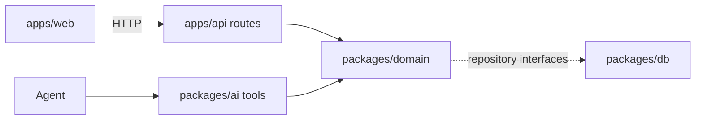
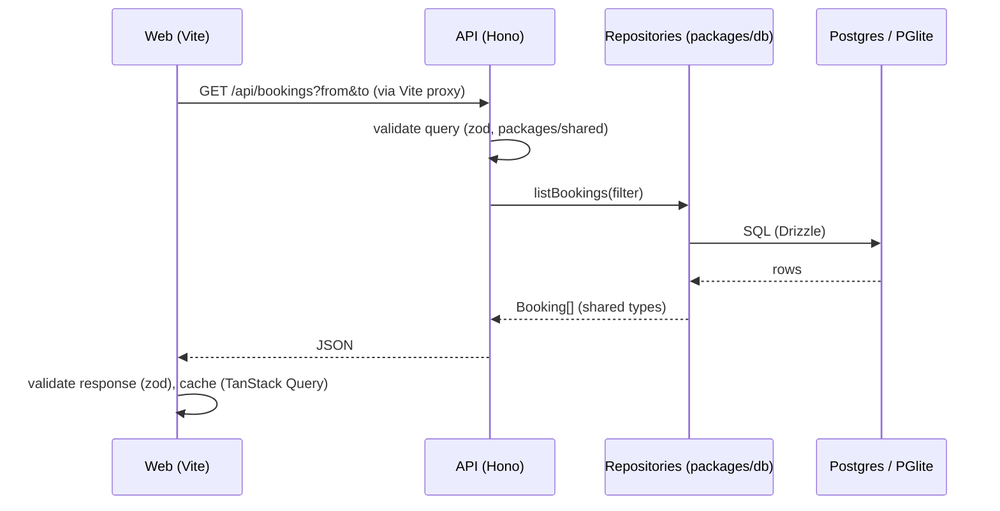

# Architecture

## Layers

Orbit PMS is a pnpm monorepo. Each layer has one job:

| Package           | Role                                                                         |
| ----------------- | ---------------------------------------------------------------------------- |
| `apps/web`        | React UI. No business logic.                                                 |
| `apps/api`        | Hono server. Thin routes that validate input and call the domain.            |
| `packages/domain` | Pure TypeScript business logic. No I/O except through repository interfaces. |
| `packages/db`     | Drizzle schema, migrations, seed, repository implementations.                |
| `packages/ai`     | Meta model provider, agent tools, prompts, evals.                            |
| `packages/shared` | zod schemas and types used across packages.                                  |

## The architecture rule

UI actions and agent tools call the same domain functions.

## Data flow

Repositories implement the interfaces declared in `packages/domain/src/repositories.ts`, so domain code never imports a database driver.
