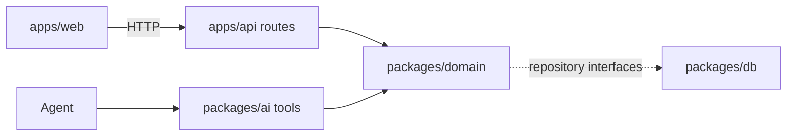
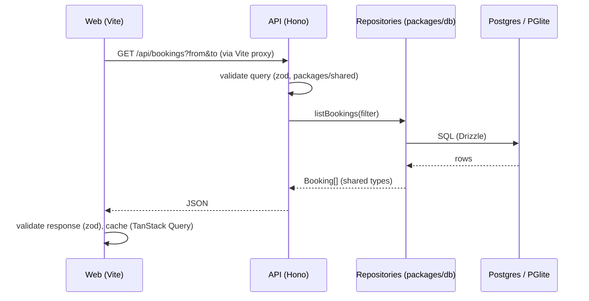

# Architecture

## Layers

Orbit PMS is a pnpm monorepo. Each layer has one job:

| Package           | Role                                                                         |
| ----------------- | ---------------------------------------------------------------------------- |
| `apps/web`        | React UI. No business logic.                                                 |
| `apps/api`        | Hono server. Thin routes that validate input and call the domain.            |
| `packages/domain` | Pure TypeScript business logic. No I/O except through repository interfaces. |
| `packages/db`     | Drizzle schema, migrations, seed, repository implementations.                |
| `packages/ai`     | Meta model provider, agent tools, prompts, evals.                            |
| `packages/shared` | zod schemas and types used across packages.                                  |

## The architecture rule

UI actions and agent tools call the same domain functions.

## Data flow

Repositories implement the interfaces declared in `packages/domain/src/repositories.ts`, so domain code never imports a database driver.

## Web UI

The app shell is a sidebar (navigation, the ⌘K button, the signed-in staff member, appearance) and one content panel per page. Each page renders its own `PageHeader` and body. Two overlays are shared by every page:

- **Command bar** (`components/command-palette.tsx`, ⌘K): search guests and today's arrivals and departures, jump to a page, switch appearance, and talk to the agent. The agent lives here rather than in a chat side panel, see [ADR 0007](decisions/0007-command-bar-for-the-agent.md). `useCommandPalette().openPalette({ mode, text })` opens it from anywhere with context, for example from a booking.
- **Booking inspector** (`components/booking-drawer.tsx`): opened by `?booking=<id>`, so any page, link or agent result can open a booking.

Styling comes from design tokens in `apps/web/src/index.css`: surfaces, text, borders, status colors for bookings and rooms, shadows and a 13 px type scale, each defined for light and dark mode. The accent is one hue (`--accent-hue`, `--accent-chroma`), so changing it re-colors every accent. Each color token has a day and a night value, blended by `--night` (light = 0, dark = 1). `--night` is a registered CSS property, so switching themes fades instead of snapping. The **daylight** theme (`lib/daylight.ts`) turns the app light at 06:30 and dark at 19:30 local time, and adds a soft glow behind and through the content panel that changes continuously: orange at sunrise, blue by day, pale blue moonlight at night. The appearance menu has a slider to preview any time of day; the pinned time is stored in the browser until "Back to now". Components use the tokens through Tailwind utilities (`bg-status-hold`, `text-primary-text`, `shadow-raised`) and never raw colors. Reusable pieces (`PageHeader`, `Section`, `PropertyList`, `BookingList`, `StatusDot`, `GuestAvatar`, `EmptyState`, `ErrorNotice`) live in `apps/web/src/components/`; shadcn primitives are in `components/ui/`.
