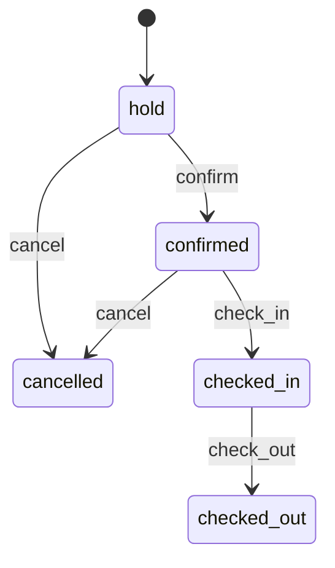

# Domain

Business logic lives in `packages/domain`. It is pure TypeScript: no network, no database driver, no env access. Entity shapes are zod schemas in `packages/shared`.

## Entities

| Entity           | Key fields                                                                                                                                                                                                      |
| ---------------- | --------------------------------------------------------------------------------------------------------------------------------------------------------------------------------------------------------------- |
| RoomType         | name, `maxAdults`, `maxChildren`, `basePrice` (per room or per adult per night, see `pricingBasis`), description                                                                                                |
| Room             | name, room type, `kind` (`room` \| `apartment`), floor, `status` (`clean` \| `dirty` \| `inspected` \| `out_of_order`)                                                                                          |
| Guest            | name, email, phone, `language` (`cs` \| `de` \| `en` \| `pl`), notes                                                                                                                                            |
| Booking          | guest, room, `checkIn`, `checkOut`, adults, `childAges`, `status`, `holdExpiresAt`, `source`, `addons` (wellness, dogs, extra beds), `priceSnapshot` (a quote), notes                                           |
| Inquiry          | a conversation: channel, guest, messages (in or out), unread, archived, parsed extraction, `status`, linked booking                                                                                             |
| HousekeepingTask | room, `type` (`turnover` \| `stayover` \| `maintenance`), `status` (`open` \| `in_progress` \| `done`), notes, `trade`, contact asked                                                                           | `stayover` \| `maintenance`), `status` (`open` \| `in_progress` \| `done`), notes |
| HotelProfile     | name, location, description, contact, `checkInFrom`, `checkOutBy`, `entries` (notes: folder, title, details with `[[links]]`, tags)                                                                             |
| Charge           | booking, label, quantity, `unitPrice` (negative for a discount), amount, `vatBracket` (`standard` \| `reduced` \| `none`), `postedOn`                                                                           |
| Payment          | booking, `kind` (`payment` \| `refund`), `method` (`cash` \| `card` \| `bank_transfer`), amount (positive), note, `paidOn`                                                                                      |
| StayGuest        | booking, guest profile (main guest only), name, `nationality` (ISO alpha-2), `dateOfBirth`, `documentType` (`id_card` \| `passport`), `documentNumber`, address, `registeredAt`, each ID field null until known |
| IdScan           | booking, stay guest (or none, for a companion still to add), `status` (`waiting` \| `reading` \| `done` \| `failed`), checked result, error, `readingSince`, `expiresAt`                                        |
| Contact          | name, `person` to ask for, `trades` (one or more), phone, email, `language` to write in, notes                                                                                                                  |
| StaffMember      | name, email, `role` (`manager` \| `receptionist` \| `housekeeping`), `active`                                                                                                                                   |
| AuditLog         | `actor` (`user` \| `agent`), action, `subjectId` (e.g. a booking), payload, timestamp                                                                                                                           |

## Booking lifecycle

`allowedActions(booking, today)` lists the actions the UI and agent may offer:

- `confirm` a hold. Fails with `conflict` if the room was taken after the hold expired.
- `check_in` a confirmed booking only on a day of the stay (`checkIn ≤ today < checkOut`). It doesn't wait for the guest book: missing IDs stay flagged on the booking ([Guest book](#guest-book)), see [ADR 0010](decisions/0010-guest-book-per-person-and-phone-id-scans.md).
- `check_out` a checked-in guest, any day. The room becomes `dirty`.
- `cancel` a hold or confirmed booking. Checked-in guests check out instead.

Anything else throws `invalid_transition`.

## Booking operations

Pure functions in `packages/domain/src/bookings.ts`, wrapped by `createHotelService` (`service.ts`), which loads data through the repositories, runs each mutation in a transaction and appends an audit entry (`actor`, `action`, `subjectId`, `payload`). Before a mutation reads a room's bookings to check for conflicts, it locks that room's row (`SELECT … FOR UPDATE`) until the transaction ends, so two requests for the same room are checked one after the other and can't both book it.

| Operation                                                     | Rules                                                                                                                                                                                                                                                                                                                                                                                                                                                                                                                                                                                            |
| ------------------------------------------------------------- | ------------------------------------------------------------------------------------------------------------------------------------------------------------------------------------------------------------------------------------------------------------------------------------------------------------------------------------------------------------------------------------------------------------------------------------------------------------------------------------------------------------------------------------------------------------------------------------------------ |
| `applyBookingAction(id, action, actor)`                       | See lifecycle above. Audit action `booking.<action>`.                                                                                                                                                                                                                                                                                                                                                                                                                                                                                                                                            |
| `moveBooking(id, roomId, actor)`                              | Same dates, different room. Booking must be `hold`, `confirmed` or `checked_in`. The target room must not be out of order, must fit the party (counting extra beds), and must be free. **The agreed price is kept**, even across room types.                                                                                                                                                                                                                                                                                                                                                     |
| `changeBookingDates(id, range, actor)`                        | Same room, new dates, **re-priced** with `quote()` and the booking's stored add-ons. Checked-in guests can only change their departure.                                                                                                                                                                                                                                                                                                                                                                                                                                                          |
| `rescheduleBooking(id, { roomId, checkIn, checkOut }, actor)` | Room and dates in one step (a tape chart drag). Same rules as a move plus a date change; a no-op throws `invalid_input`. The price is kept if only the room changes and re-quoted in the target room's type if the dates change.                                                                                                                                                                                                                                                                                                                                                                 |
| `updateBooking(id, patch, actor)`                             | Any of room, dates, party (`adults`, `childAges`), `addons`, `source`, `notes` in one step. Room and dates follow the move and date-change rules, the party must fit the target room (counting extra beds), and checked-in guests keep their arrival date. **Re-priced** when dates, party or add-ons change; a room change alone keeps the agreed price. Checked-out and cancelled bookings only take note changes; a patch that changes nothing throws `invalid_input`. Audit action `booking.update` with the changed fields and totals. `previewUpdate` runs the same checks without saving. |
| `switchHold(id, patch, actor)`                                | A hold moved to another room before the guest agreed to a price (holding another room offered for an inbox request). The rules of `updateBooking`, but the stay is always **re-quoted** in the new room's type. Only a `hold` switches (`invalid_transition`), and only to another room (`conflict`). Audited as `booking.update`.                                                                                                                                                                                                                                                               |
| `getBookingDetail(id)`                                        | Booking with guest, room, room type and `allowedActions`.                                                                                                                                                                                                                                                                                                                                                                                                                                                                                                                                        |
| `getDayOverview(date)`                                        | `arrivals` (check-in that day: hold, confirmed or already checked in), `departures` (check-out that day: checked in or already checked out), `inHouse` (arrived earlier, leaving later). Defaults to today at the hotel.                                                                                                                                                                                                                                                                                                                                                                         |

## Holds and agent proposals

`createBooking(input, actor)` is what staff use: the same as a hold, or `status: 'confirmed'` straight away (a phone or walk-in booking), which never lapses (audit action `booking.create`). `roomOptions(query)` lists the free rooms for a stay, cheapest first, each with an exact quote including add-ons; `excludeBookingId` leaves out the booking being edited.

`createHold(input, actor)` creates a `hold` for an existing guest (`guestId`) or a new guest record, priced with `quote()` and stored add-ons. Rules: valid dates, check-in not in the past, room not out of order, party fits, room free. The hold expires after `hotelPolicy.holdHours` (placeholder: 48).

Every mutation also has a `preview*` variant that runs the same rules against current data without saving. `createPendingActionService` uses these to validate agent proposals, store them as pending actions, and execute them only on confirmation, as the staff member who confirmed (`confirm(id, by)`): a reply sent from a conversation is signed with their name, and manager-only changes (local events, rooms) check that they are a manager. Proposals also cover the inbox (send a reply, hold a room for a request through `inbox.previewHold`, decline), deleting a Knowledge note by title, local events and room details. See [ai.md](ai.md#approval-pattern).

`searchBookings` matches guest names ignoring case and accents (`novak` finds `Novák`).

## Inbox

`createInboxService` (`inbox-service.ts`) keeps conversations with guests from every channel in one stream. Sending records a message; delivering it is a transport's job outside Orbit.

- `create(message)`: a guest's first message starts an unread conversation. `compose(body, author, actor)`: the hotel writes first (`inquiry.compose`).
- `receive(id, body)`: the guest writes again. The conversation is unread, leaves the archive, needs a reply (`new`) unless it is `converted` or `declined`, and its prepared reply is dropped; the parsed request stays for holding a room.
- `send(id, body, author, actor)`: the hotel's reply, signed by the staff member; the conversation becomes `replied` unless settled, and the draft is used up (`inquiry.replied`).
- `setUnread(id, unread)`, `setArchived(id, archived)`, `saveTranslation(id, messageId, translation)`.

- `inboxOptions(analysis)`: for a complete booking request, up to three free rooms, one per room type, cheapest first, each with an exact quote. An apartment is required if the guest asks for one, or brings a dog (`hotelPolicy.dogsAllowedIn`, placeholder: apartments only). Wellness and a dog become quote add-ons.
- `saveProcessing(id, result)`: stores the agent's extraction and suggestion; a `new` message with options becomes `quoted`.
- `createHold(id, roomId, actor)`: a hold for the requested stay in the chosen room. Reuses a guest whose email matches the sender (case-insensitive), otherwise creates one. The hold and the message's `bookingId` are saved in one transaction. If the message already has a hold, it moves to the chosen room and is quoted there (`switchHold`); once that booking is confirmed or later, holding again is a `conflict`.
- `decline(id, actor)`: marks a message `declined`, unless it already led to a booking (`invalid_transition`).
- `refreshOptions(id)`: looks for rooms again for a request that was read, e.g. one that had none when a cancellation frees a room. The old draft is dropped; a `new` message with rooms becomes `quoted`. `invalid_transition` before the request is read.

## Guests

`createGuestService` (`guests.ts`) creates and edits guest records (`name`, `email`, `phone`, `language`, `notes`). An email may belong to only one guest, ignoring case (`conflict`), because the inbox recognises returning guests by email. Changes are audited as `guest.create` and `guest.update` with the guest as subject.

## Housekeeping

`packages/domain/src/housekeeping.ts` and `housekeeping-service.ts`.

- **Room status** is `dirty`, `clean`, `inspected` or `out_of_order`. Staff may set any status, except straight from `out_of_order` to `clean` or `inspected`: a repaired room is marked `dirty` and cleaned first.
- **Tasks** are `turnover`, `stayover` or `maintenance`, each `open`, `in_progress` or `done`. A maintenance task needs a description. Setting a room `clean` or `inspected` completes its open turnover and stayover tasks.
- **Board**: every room with what happens in it today, from the bookings: `turnover` (one guest leaves, another arrives), `arriving`, `departing`, `staying` or `vacant`. A room is **urgent** when a guest arrives today and it is not `inspected`. Urgent rooms come first, then by occupancy, then the heavier cleans, then by name: effort orders rooms with the same deadline, it never moves one ahead of an arrival.
- **Cleaning effort** (`cleaning-effort.ts`): each room is a `light`, `standard` or `heavy` clean today, with short `cues` saying why ("Dog", "2 kids", "Cot"). Points: a departure or turnover 2, a stayover 1, an arrival into an empty room 0. The stay being cleaned adds 2 for dogs (booked, or mentioned in its notes), 1 per child up to 2, 1 for a stay of 7 nights or more that leaves, and 1 or 2 for extra mess its notes mention; the arriving stay adds 1 for anything to set up (an extra bed, or what its notes ask for). Under 2 is light, 4 or more heavy. A room with no cleaning left (inspected, or clean without a cleaning task) has no effort but keeps its cues; a vacant room has neither.
- **Stay readings**: what the model read from a stay's booking notes, guest notes and the guest's own latest messages about the booking (`staySource`): pets, extra mess with a reason, and things to set up. Each is stored with the text it was read from; when that text changes the stay counts as unread (`unreadStays` on the board) and is read again, and the old reading counts until then. The domain trims cues to a few words and saves a stay the model skipped as nothing unusual, so it is not sent again.
- **Notes**: a housekeeping note (voice or typed) is read by the model into room/status/issue updates. The domain resolves the room names (whole words: "pokoj 104", "A 1"), applies status changes and creates maintenance tasks in one transaction, and skips updates for unknown rooms or forbidden changes with a reason. A note saying a room is clean leaves an already inspected room inspected.
- Every change is written to the audit log (`room.status`, `task.create`, `task.status`), with the room as subject.

## Contacts and repairs

`createContactService` (`contacts.ts`). Contacts are the hotel's suppliers and contractors, each with one or more **trades**: `plumbing`, `electrical`, `heating`, `appliances`, `internet`, `locks`, `pests`, `building`, `cleaning`, `supplies` ([ADR 0020](decisions/0020-contacts-and-repairs-by-trade.md)).

- A maintenance task has a `trade` (null for cleaning, or when it isn't clear) and the contact asked to fix it. The model sets the trade when it reads a housekeeping note or a repair added by hand; the agent sets it when it logs one.
- `contactsForTrade` lists the contacts for a task's trade, the one last asked to fix something of that trade first, then by name.
- `roomAccess` says when someone can work in the room without disturbing a guest: from today, or from the day the guests in it leave (back-to-back stays count as one), until the next guest arrives. Lapsed holds and cancellations don't count.
- `repair(taskId)` returns the task with its room, access, contacts for its trade and the contact already asked. `askToRepair(taskId, contactId, actor)` records who was asked (by phone or email), moves the task to `in_progress` and gives a task without a trade the contact's first one. A done task can't be asked about.
- Contacts are created, edited and deleted by staff or through confirmed agent proposals (`save_contact` sends only what changes, `remove_contact`). Deleting a contact keeps the tasks that name them.
- Audit actions: `contact.create`, `contact.update`, `contact.remove` (the contact as subject), `task.contact` (the room as subject).

## Knock-ons

`createKnockOnService` (`knock-on.ts`) works out what a change made worth doing next, from current data each time ([ADR 0018](decisions/0018-knock-ons-worked-out-on-read.md)).

- **Relocate**: for each out-of-order room, the stays in it that are in house or arrive within `RELOCATION_DAYS` (7) and still hold the room. `planRelocations` gives each a free room for the whole stay that the party fits, dogs allowed if they bring one: the same room type first, then a clean or inspected room when the guest is here or arrives today, then the room type closest in price, then by name. A room is never planned for two overlapping stays; back-to-back stays may share it. A stay with no free room is listed with none. Moving keeps the booked price.
- **Opening**: a request that was read when nothing was free (`suggestion.options` empty), still `new` or `replied`, not archived, without a booking and not in the past, that `inboxOptions` now finds rooms for, with how many and the cheapest total.
- **Repair**: an `open` maintenance task with a trade that nobody was asked to fix yet, with the first contact for its trade. It goes once someone is asked or the task is started.
- `relocate({ moves }, actor)` moves the stays one by one through `moveBooking`, with its checks and audit entries.

## Daily brief

`buildDailyBrief` (`packages/domain/src/brief.ts`), via `getDailyBrief(date)` on the hotel service, sums up a day for the staff. It is computed from current data on every request; no model is involved.

| Field                       | Meaning                                                                                                                                                                                       |
| --------------------------- | --------------------------------------------------------------------------------------------------------------------------------------------------------------------------------------------- |
| `occupancy`                 | Rooms taken tonight (`occupied`) out of rooms not out of order (`sellable`) and all rooms (`total`). A lapsed hold does not count.                                                            |
| `guestsTonight`             | Adults and children in the rooms taken tonight.                                                                                                                                               |
| `arrivals`, `departures`    | Counts, as in the day overview.                                                                                                                                                               |
| `turnovers`                 | Rooms where one guest leaves and another arrives today, with the room status.                                                                                                                 |
| `roomsToPrepare`            | Rooms a guest arrives in today (not yet checked in) that are not `inspected`.                                                                                                                 |
| `holds`                     | Unconfirmed holds that lapsed, lapse within 24 hours, or arrive within 7 days, by check-in.                                                                                                   |
| `outOfOrder`, `maintenance` | Out-of-order rooms and open maintenance tasks.                                                                                                                                                |
| `missingIds`                | Stays arriving today (confirmed) or in house tonight whose guest book is incomplete, with the number of people missing (as `missingIds` on the booking) and whether they are still to arrive. |
| `unansweredMessages`        | Inbox messages that are `new` or `quoted`.                                                                                                                                                    |
| `gaps`                      | Runs of 1–2 empty nights between two stays in the same room, starting within the next 14 days, worth a discount. A run already under way counts from today. Out-of-order rooms are skipped.   |

## Hotel profile

`createSettingsService` (`settings.ts`) keeps the hotel profile: the property's name, location, description, contact details, check-in and check-out times, and a list of entries: the notes in Knowledge. Each is filed in one of seven fixed folders (`policies`, `rooms`, `food`, `wellness`, `activities`, `getting_here`, `services`; [ADR 0019](decisions/0019-knowledge-as-a-vault-filed-by-orbit.md)), carries up to six tags (`normalizeTags`: lowercase, no `#`, no repeats), and may link to other notes as `[[Title]]` in its text (`packages/shared/src/notes.ts`). Entries stored with the old categories read as folders: `policy` as `policies`, `amenity` and `info` as `services`. The agent's prompts are built from it ([ai.md](ai.md#prompts)).

- Until a profile is saved, `getProfile()` returns an empty one (`emptyHotelProfile`).
- `updateProfile(profile, by)` replaces the property details; only an active manager may (`forbidden`). The entries stay as stored, whatever the body says: they are kept in Knowledge, so a Settings form opened earlier can't undo a fact saved since. Entry IDs must be unique and check-out must be earlier in the day than check-in, so rooms can be turned over (`invalid_input`). It writes `settings.profile` to the audit log with who saved it (`by`) and the names of the changed fields; a save that changes nothing writes nothing.
- An entry may have an `until` date: a temporary notice, e.g. "Sauna closed". After that day it is left out of what guests are told (`currentEntries(profile, today)`), and Knowledge shows it as ended. Each entry also records who last wrote it (`source`: `staff`, `agent` or `reply`) and when (`updatedAt`); seeded entries have neither.
- **Knowledge** is where the entries are kept, by any active staff member (`forbidden` otherwise): `saveEntry(id, draft, by)` adds an entry (`id` null) or edits one, in any folder; titles stay unique, ignoring case (`conflict`), and a new end date must be today or later (`invalid_input`). Renaming a note rewrites links to it in other notes (`withRenamedLinks`), unless the longer title would push one past 1000 characters. `removeEntry(id, by)` deletes one. Audited as `settings.entry` and `settings.entry_remove` with who did it.
- `saveHotelInfo(proposal, actor)` saves one fact, as staff confirm it from the agent or from a reply they sent (`save_hotel_info` proposal, `source` `agent` or `reply`). It replaces the entry with the same title, ignoring case, in any category, or adds one with a new ID; a notice with an `until` may not replace an entry that always applies, and one that has already ended is refused (`invalid_input`), as is a new entry beyond 100. Audited as `settings.entry`.
- Rules the system enforces (hold length, which room kinds take dogs, prices) stay in `hotelPolicy` and the rates, not in the profile.

## Activity

`createActivityService` (`activity.ts`) lists the audit log hotel-wide, newest first, optionally only the agent's or only staff changes. `describeActivity` names each entry's subject from its action prefix (`booking.*` and `folio.*` → the booking as "guest, room"; `room.*` and `task.*` → the room; `room_type.*`, `guest.*`, `staff.*`, `inquiry.*`) and the staff member recorded as `by` in its payload. A subject that no longer exists is left unnamed.

## Guest book

`createRegistrationService` (`registration.ts`) keeps the guest book: one entry per person staying in the room (`StayGuest`). The main guest's entry has the fixed ID `sg_<bookingId>` and takes its name from their profile; it exists in the book before anything is recorded. Companions are added by name, with ID details if known.

What an entry needs depends on the country in the hotel profile (`guestBookRulesFor`, [ADR 0013](decisions/0013-configurable-region-us-demo.md)). `missingFields(person, today, rules, primary)` lists it:

- **US**: only the guest who booked needs an entry, with an ID document (type and number). Companions may be listed but need nothing.
- **Elsewhere** (the Czech rules): everyone in the room, with nationality and date of birth; a document type and number from 15 (Czech ID cards are compulsory then) or when the age is unknown; and a home address when the nationality is not the hotel's country.

`buildGuestBook` returns everyone (main guest first, then companions in the order they were added), the party size (adults plus children) and `missing`: people with an incomplete entry, plus, where everyone is recorded, people the party counts that nobody added yet. `BookingDetail.missingIds` is the same number. `extra` counts people listed beyond the party, which happens when the party is made smaller after companions were added; the inspector and the check-in flow warn about it.

- `getGuestBook(bookingId)` also returns the main guest's details from their latest earlier stay, to prefill.
- `addGuest(bookingId, body, actor)` adds a companion, up to the party size (`over_capacity`).
- `updateGuest(bookingId, stayGuestId, patch, actor)` changes a name or ID fields; `null` clears one. The main guest's name is changed on their profile (`invalid_input`).
- `removeGuest(bookingId, stayGuestId, actor)` takes a companion off; the main guest stays (`invalid_input`).
- Any status but `cancelled` may change (`invalid_transition`), so a missing ID can be added after check-in or check-out. A date of birth must be in the past (`invalid_input`).
- Audited on the booking as `booking.add_guest`, `booking.update_guest` and `booking.remove_guest` with the stay guest ID and the names of the changed fields, never their values. `scanned: true` marks values from an ID scan; saving them deletes the scan in the same transaction.
- Check-in does not wait for the guest book, and the agent's check-in proposal says how many guests still need an ID.

## ID scans

`createIdScanService` (`id-scan.ts`) runs phone scans of ID documents. The domain never sees the photo: the API has the vision model read it and passes the reading in.

1. `start(bookingId, stayGuestId | null)` opens a scan for one person, or for a companion still to add, and deletes expired scans. Its ID is an unguessable token (144 random bits from the API) and the only key to the phone link; it expires after `idScanMinutes` (15).
2. `getForPhone(id)` returns only the status, the person's first name and the room, never the result.
3. `beginReading(id)` marks a photo as being read and when (`conflict` while one already is); a retake after `done` or `failed` is fine. A read still running after 90 seconds (`ID_SCAN_READ_TIMEOUT_MS`) was cut off, e.g. by a server timeout, and counts as `failed` with a retake message, so it can't block the link until it expires. `complete(id, reading)` stores the checked result, or fails with a retake message when the model says the photo shows no readable ID. `fail(id, message)` records a failed model call.
4. `getForDesk(bookingId, id)` returns the result to the booking that opened the scan. Staff review and save it to the guest book; nothing is saved before that.

`checkReading(reading, today)` turns the model's reading into reviewable values: names printed in capitals are title-cased (`tidyName`), the nationality must be two letters, dates must be real `YYYY-MM-DD` days and a birth date in the past, the document number loses spaces and must be 3 to 30 characters. Anything malformed is dropped rather than guessed. An expired document, an impossible birth date and a document that is not an ID card or passport become warnings for staff.

An unknown, expired or already saved scan is `not_found`.

## Billing

`createBillingService` (`billing.ts`) keeps each booking's bill (folio). `buildFolio(booking, charges, payments, pricing)` builds it:

1. **Stay**: the booking's `priceSnapshot` lines, verbatim. A cancelled booking has no stay lines.
2. **City tax**: `cityTax.perPersonPerNight` × paying guests × nights, at the current rate. Every adult pays; children pay from `cityTax.minAge` (default 18, so children don't). No line when the rate is 0. It is billed on the folio, not in `quote()`.
3. **Extras**: charges staff or the agent posted, e.g. sauna or minibar.

`charged` is the sum of the lines, `paid` is payments minus refunds, and `balance = charged - paid` (negative: the guest is owed money).

**Tax.** Every line carries a `vatBracket` and its `vatRate` from the rates' `tax`: `reduced` is the lodging bracket (accommodation, child and long-stay discounts, extra beds: the Czech reduced VAT, or a US occupancy tax), `standard` everything else (wellness and dogs, to be confirmed for Czechia, and extras by default: standard VAT, or a US sales tax), `none` outside tax (city tax). Each bracket has a name and a rate with up to two decimals. With `tax.mode` `inclusive` (VAT) the prices include tax and `vatSummary` takes it out of each bracket's total: `vat = round(gross × rate / (100 + rate))`, `net = gross − vat`. With `exclusive` (US) the prices are before tax: `vat = round(net × rate / 100)`, `gross = net + vat`, and the bill adds one `tax` line per bracket, e.g. "Occupancy tax 12%". Either way the rounding happens once per bracket in whole units, half away from zero so a discount's tax mirrors a charge's. The folio states its `taxMode` and `currency`.

- `addCharge` / `updateCharge` / `removeCharge` need a `confirmed` or `checked_in` booking (`invalid_transition`): a hold isn't a sale yet, and a checked-out bill is closed. A charge is posted on the hotel's today. `updateCharge` changes the label, quantity, unit price or tax bracket in place and recomputes the amount. Previews give the balance after the change with its taxes.
- `recordPayment` takes payments in any status except `cancelled`, where only refunds are possible. A refund can't exceed what was paid (`invalid_input`).
- `previewCharge` / `previewPayment` run the same checks without saving and return the balance after, for agent proposals.
- Audited on the booking as `folio.charge`, `folio.update_charge` (with the changed fields), `folio.remove_charge`, `folio.payment` and `folio.refund`.

## Reports

`buildReport({ from, to }, data)` (`reports.ts`) measures the nights `[from, to)`, at most 366. `createReportService` loads the data for it.

- **Sold** stays are `confirmed`, `checked_in` and `checked_out`; holds and cancellations don't count.
- **Room nights**: available = rooms × nights; sold = nights of sold stays inside the period. Occupancy = sold / available, as a fraction.
- **Revenue** comes from each booking's `priceSnapshot`, spread evenly over its nights in whole units so the nightly shares add up exactly (`nightlyShare`). A stay that crosses the period's edge counts only its nights inside. Room revenue is accommodation after child and long-stay discounts; add-on revenue is wellness, extra beds and dogs. Extras are the charges posted in the period. City tax is reported apart: it is collected for the town.
- **ADR** = room revenue / room nights sold; **RevPAR** = room revenue / room nights available. Both rounded to whole units.
- Guest nights, arrivals in the period and their average stay, and cancellations with a night in the period.
- Room nights and room revenue by booking source and by room type (with each type's occupancy), payments minus refunds by method on days in the period, departed guests (check-out inside the period) who still owe, and a daily series of rooms sold, occupancy and room revenue.
- `previousPeriod(query)` is the same length right before, for comparisons.

## Rates and rooms

`createRatesService` (`rates.ts`) keeps the rates (the `PricingConfig` that `quote()` reads), room types and rooms. Anyone may read them; every change needs an active manager (`forbidden`) and is audited with `by` in the payload.

- The rates include `currency` (`USD`, `EUR` or `CZK`; amounts are never converted), `pricingBasis` (`per_room` or `per_person`) and `tax` (`mode` `inclusive` or `exclusive`, and a `label` and `rate` for the `standard` and `reduced` brackets). Rates saved before these existed read as CZK, per person, with Czech VAT included (21 and 12).
- The rates include `cityTax` (`label`, `perPersonPerNight`, `minAge`), billed on the folio, e.g. "City tax" or "Tourism fee". Rates saved before it existed read it as 0.
- Until rates are saved, `getPricing()` returns the Czech defaults from `pricing/config.ts` (placeholders). The demo seed saves the US lodge's `usDemoPricing` (or the Czech defaults with `SEED_REGION=cz`).
- `updatePricing(config, by)` replaces the rates. Season days must be real `MM-DD` days (29 February counts) and season names unique, child tiers must go up in age, and there is one long-stay tier per length (`invalid_input`). Audited as `settings.pricing` with the changed fields; a save that changes nothing writes nothing.
- `createRoomType` / `updateRoomType` set the name, capacity, base price and description (`room_type.create`, `room_type.update`; a price change logs the old and new base price).
- `createRoom` / `updateRoom` set the name, room type, kind and floor. Room names are unique, ignoring case (`conflict`), and the room type must exist (`not_found`). New rooms start `clean`; an edit keeps the housekeeping status (`room.create`, `room.update`).
- The rates include `adjustments`: per-night changes `{ date, percent }` on top of the season, for every room type (−50 to +100, one per night). `adjustRates(nights, actor, by)` sets each night to its percent, 0 removing it; a manager does it from the Rates page, the agent through a proposal (`adjust_rates`). Audited as `rates.adjust` with each night's old and new percent; nights that would not change are skipped. Rates saved before it existed read as none.
- The hotel service reads the saved rates inside each operation's transaction. Existing bookings keep their `priceSnapshot`; only new quotes and re-pricing (date or party changes) use new rates.

## Rate outlook

`buildOutlook` (`revenue.ts`) and `createRevenueService` (`revenue-service.ts`) describe the next nights (60 on the Rates page) for rate decisions. Weather is loaded outside the domain and passed in.

- **Per night**: rooms sold (bookings not cancelled whose stay covers it) of rooms that can be sold (all but out of order), how full that weekday usually ends up (`typicalOccupancy`, the average over the eight weeks before today), the night's current adjustment, the local events on it, the forecast, and expected no-shows (the sum of the arrivals' no-show chances).
- **Suggested rate**: the factors that apply add up, rounded to 5 and kept within −20 and +30 (`rateRules`, illustrative values for the demo, not tuned on a real hotel). Demand: almost full (90% or more) +20, otherwise 15 points busier than the usual weekday +10, or, within a week, 20 points quieter −10. Events: the biggest of the night, small +5, medium +10, big +15. Weather: 5 cm of fresh snow or more +5, a storm or 20 mm of rain or more −5. With no factor the night keeps its current adjustment, so a manager's own change is never suggested away.
- **No-show chance** of a confirmed arrival (`noShowChance`): 3%, +7% booked through an OTA, +5% with no deposit, +10% when the guest cancelled a stay before, −2% when they have stayed before, at least 1%. Only how the stay was booked and the guest's own history count, never who the guest is or where they come from. The outlook lists this week's arrivals at 10% or more, riskiest first.
- **Local events** (`LocalEvent`: `name`, `firstNight`, `lastNight`, `impact` `low` | `medium` | `high`) are added and removed by a manager (`event.create`, `event.delete`). The demo seeds four mock events, dated from today; the seed nearly fills the big one's weekend.

## Staff

`createStaffService` (`staff.ts`) keeps the team. See [ADR 0009](decisions/0009-staff-roles-and-demo-sign-in.md).

- `identify(id)` returns the active staff member with that ID, or null. It is how a request is signed in.
- `create(input, by)` and `update(id, patch, by)` need `by` to be an active manager (`forbidden`). Emails are unique, ignoring case (`conflict`). No change may leave the team without an active manager (`invalid_input`). Members are deactivated, never deleted.
- Changes are audited as `staff.create` and `staff.update`, with the member as subject and `by` in the payload.

## Availability rules

`checkAvailability(query, { rooms, roomTypes, bookings, now })` returns rooms that can take the whole stay, cheapest room type first.

- Stays overlap only if they share a night. Checking in on another guest's check-out day is fine (same-day turnover).
- `confirmed` and `checked_in` bookings block a room. A `hold` blocks it until `holdExpiresAt`. `cancelled` and `checked_out` never block.
- `out_of_order` rooms are never offered.
- Capacity: adults ≤ `maxAdults`, and adults + children ≤ `maxAdults + maxChildren` (children may use adult beds). Extra beds raise both limits by one each.
- Optional filters: `kind`, `roomTypeId`, and `excludeBookingId` (to move or extend an existing booking).
- Invalid input throws `DomainError`: zero-night or reversed ranges, no adults, child ages outside 0–17.

## Pricing rules

`quote(input, pricing)` returns a line-item breakdown whose amounts sum to `total`. The rates are edited on the Rates page ([Rates and rooms](#rates-and-rooms)); the defaults in `packages/domain/src/pricing/config.ts` and the seeded base prices **are placeholders until replaced with real prices.**

1. **Accommodation**: `basePrice × season multiplier × (1 + the night's adjustment)`, rounded to whole units, per guest per night (`per_person`) or per room per night (`per_room`). One line per season and adjustment the stay touches, e.g. "Room, 2 nights (standard, +15%)". Taxes are not part of a quote: they are included in the prices or added on the bill.
2. **Seasons** are `MM-DD` ranges, inclusive of both nights, and may wrap the new year (`12-20` → `03-15`). The first matching season wins; other nights use multiplier 1.
3. **Child discounts** (per-person rates only): each child gets the first tier with `age ≤ maxAge`; the discount is a fraction of that night's adult rate (1 = free). Older children pay the adult rate.
4. **Long stay**: the tier with the highest `minNights` the stay reaches takes a fraction off accommodation, after child discounts. Add-ons are not discounted.
5. **Add-ons**: wellness (per eligible guest per night, from `wellness.minAge`), extra bed (per bed per night), dog (per dog per night).
6. Parties that don't fit the room type (counting extra beds) throw `over_capacity`.

## Conventions

- Stays are half-open date ranges `[checkIn, checkOut)`. Dates are stored as `YYYY-MM-DD`.
- The hotel time zone is set at startup with `setHotelTimeZone` (`HOTEL_TIMEZONE`; default `America/Los_Angeles`). `hotelToday(now)` gives the hotel's calendar date.
- Money is integer whole units of the rates' `currency`. No floats. `formatMoney` writes "$1,250" or "12 500 CZK".
- Domain functions take `now` as an argument instead of reading the clock.
- I/O goes through repository interfaces (`packages/domain/src/repositories.ts`) implemented in `packages/db`.
