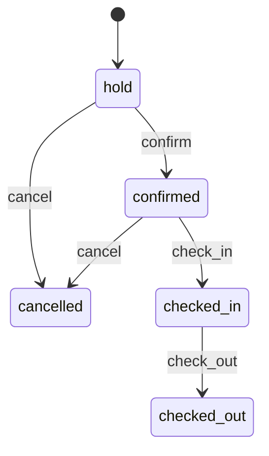

# Domain

Business logic lives in `packages/domain`. It is pure TypeScript: no network, no database driver, no env access. Entity shapes are zod schemas in `packages/shared`.

## Entities

| Entity           | Key fields                                                                                                                                                            |
| ---------------- | --------------------------------------------------------------------------------------------------------------------------------------------------------------------- |
| RoomType         | name, `maxAdults`, `maxChildren`, `basePrice` (adult rate per person per night, CZK), description                                                                     |
| Room             | name, room type, `kind` (`room` \| `apartment`), floor, `status` (`clean` \| `dirty` \| `inspected` \| `out_of_order`)                                                |
| Guest            | name, email, phone, `language` (`cs` \| `de` \| `en` \| `pl`), notes                                                                                                  |
| Booking          | guest, room, `checkIn`, `checkOut`, adults, `childAges`, `status`, `holdExpiresAt`, `source`, `addons` (wellness, dogs, extra beds), `priceSnapshot` (a quote), notes |
| Inquiry          | raw text, channel, received at, parsed extraction, `status`, linked booking                                                                                           |
| HousekeepingTask | room, `type` (`turnover` \| `stayover` \| `maintenance`), `status` (`open` \| `in_progress` \| `done`), notes                                                         |
| AuditLog         | `actor` (`user` \| `agent`), action, `subjectId` (e.g. a booking), payload, timestamp                                                                                 |

## Booking lifecycle

`allowedActions(booking, today)` lists the actions the UI and agent may offer:

- `confirm` a hold. Fails with `conflict` if the room was taken after the hold expired.
- `check_in` a confirmed booking only on a day of the stay (`checkIn ≤ today < checkOut`).
- `check_out` a checked-in guest, any day. The room becomes `dirty`.
- `cancel` a hold or confirmed booking. Checked-in guests check out instead.

Anything else throws `invalid_transition`.

## Booking operations

Pure functions in `packages/domain/src/bookings.ts`, wrapped by `createHotelService` (`service.ts`), which loads data through the repositories, runs each mutation in a transaction and appends an audit entry (`actor`, `action`, `subjectId`, `payload`).

| Operation                               | Rules                                                                                                                                                                                                                                        |
| --------------------------------------- | -------------------------------------------------------------------------------------------------------------------------------------------------------------------------------------------------------------------------------------------- |
| `applyBookingAction(id, action, actor)` | See lifecycle above. Audit action `booking.<action>`.                                                                                                                                                                                        |
| `moveBooking(id, roomId, actor)`        | Same dates, different room. Booking must be `hold`, `confirmed` or `checked_in`. The target room must not be out of order, must fit the party (counting extra beds), and must be free. **The agreed price is kept**, even across room types. |
| `changeBookingDates(id, range, actor)`  | Same room, new dates, **re-priced** with `quote()` and the booking's stored add-ons. Checked-in guests can only change their departure.                                                                                                      |
| `getBookingDetail(id)`                  | Booking with guest, room, room type and `allowedActions`.                                                                                                                                                                                    |
| `getDayOverview(date)`                  | `arrivals` (check-in that day: hold, confirmed or already checked in), `departures` (check-out that day: checked in or already checked out), `inHouse` (arrived earlier, leaving later). Defaults to today at the hotel.                     |

## Availability rules

`checkAvailability(query, { rooms, roomTypes, bookings, now })` returns rooms that can take the whole stay, cheapest room type first.

- Stays overlap only if they share a night. Checking in on another guest's check-out day is fine (same-day turnover).
- `confirmed` and `checked_in` bookings block a room. A `hold` blocks it until `holdExpiresAt`. `cancelled` and `checked_out` never block.
- `out_of_order` rooms are never offered.
- Capacity: adults ≤ `maxAdults`, and adults + children ≤ `maxAdults + maxChildren` (children may use adult beds). Extra beds raise both limits by one each.
- Optional filters: `kind`, `roomTypeId`, and `excludeBookingId` (to move or extend an existing booking).
- Invalid input throws `DomainError`: zero-night or reversed ranges, no adults, child ages outside 0–17.

## Pricing rules

`quote(input, pricingConfig)` returns a line-item breakdown whose amounts sum to `total`. Config lives in `packages/domain/src/pricing/config.ts`. **All values there are placeholders until replaced with real prices.**

1. **Accommodation** is per person per night: `basePrice × season multiplier`, rounded to whole CZK. One line per season the stay touches.
2. **Seasons** are `MM-DD` ranges, inclusive of both nights, and may wrap the new year (`12-20` → `03-15`). The first matching season wins; other nights use multiplier 1.
3. **Child discounts**: each child gets the first tier with `age ≤ maxAge`; the discount is a fraction of that night's adult rate (1 = free). Older children pay the adult rate.
4. **Long stay**: the tier with the highest `minNights` the stay reaches takes a fraction off accommodation, after child discounts. Add-ons are not discounted.
5. **Add-ons**: wellness (per eligible guest per night, from `wellness.minAge`), extra bed (per bed per night), dog (per dog per night).
6. Parties that don't fit the room type (counting extra beds) throw `over_capacity`.

## Conventions

- Stays are half-open date ranges `[checkIn, checkOut)`. Dates are stored as `YYYY-MM-DD`.
- Hotel timezone is `Europe/Prague`. `hotelToday(now)` gives the hotel's calendar date.
- Money is integer whole CZK. No floats.
- Domain functions take `now` as an argument instead of reading the clock.
- I/O goes through repository interfaces (`packages/domain/src/repositories.ts`) implemented in `packages/db`.
